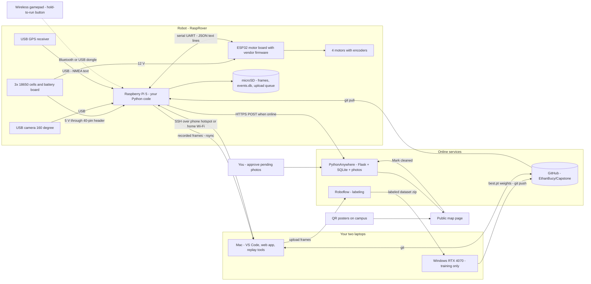

# LitterBot Capstone Plan (2026–27)

*Written Sep 16, 2026 for Ethan Bucy · commit as `docs/PLAN.md` in `EthanBucy/Capstone`*

> **Guiding principle: Simplicity Is Paramount to Being Successful.**
> Pace rule: planned weeks never exceed 5.5 h. If a week runs over, stop, write one line in the journal, and carry the task forward. No grinding.

**How to use this document**

- Every Sunday: open **§6**, find the week, copy its checklist into Notion, and start with "Learn first."
- Every technical term is explained in plain words the first time it appears, and again in the **Glossary (§9)**.
- Prices were checked on the web on Sep 16, 2026. Items I could not verify are flagged **(estimate)** and repeated in **§10**.
- Hours are written as ranges. The first number is "it went smoothly," the second is "normal beginner friction."

---

## 1. Executive summary

### The project in one sentence

A shoebox-sized four-wheel robot drives one campus sidewalk route at slow walking pace, spots litter with a camera and a small neural network, saves a photo plus GPS location, and later uploads it to a simple website with a map where anyone can mark a spot as cleaned.

### The plan in seven lines

| When | What happens | Why then |
|---|---|---|
| Sep 16 – Oct 31 | Set up tools, build the robot, drive it with a gamepad, record video + GPS on your route with staged litter, train a first rough model | Salem is dry and light in the evening now. From late October it is wet and dark by 5 pm. Outdoor data has to be collected **now**. |
| November | 1–1.5 h/week of labeling photos in 20–30 minute sittings | Your research poster comes first. Labeling is low-brain work that fits small gaps. |
| Winter break | Build and deploy the website from your Mac in three 3-hour sessions. Two weeks fully off. | Web work needs no robot, so it travels. Master's applications are usually due Dec–Jan, so this stretch stays light. |
| Jan 17 – Feb 13 | Train the real models, run them on the robot, connect robot → website | Ends with the **minimum bar complete** on Feb 13. |
| Feb 14 – Mar 20 | Self-driving on the home route, tested on dry Sundays | Needs everything above to exist first. |
| Spring break | Rest | You present three weeks later. A rested brain debugs faster. |
| Mar 28 – Apr 16 | Dress rehearsal, backup video, one buffer week for polish or fun extras, slides, present | Buffer is used for extras **only if** you are on track. |

### What I changed from your original ideas, and why

| # | Your idea | My recommendation | Reason |
|---|---|---|---|
| 1 | M5Stack RoverC-Pro | **Waveshare RaspRover** (kit without a Raspberry Pi, no pan-tilt), $174.99 | The RoverC-Pro is a 120 × 75 mm, 169 g desk toy with a 700 mAh cell. It cannot carry a computer, cannot cross sidewalk joints, and would run a Raspberry Pi for minutes, not hours. Details in §2. |
| 2 | Minimum bar = the car drives itself | **Minimum bar = the whole litter pipeline works while you drive by gamepad.** Self-driving on one route is the headline *target*, built right after. | A minimum bar should be the thing you can guarantee. Self-driving is the riskiest, most weather-dependent piece and it depends on everything else (robot, camera, models, safety). Building the pipeline first means that on Feb 13 you already have a complete, presentable project, and everything after that is upside. You still build autonomy. The order just protects you. |
| 3 | Drives "campus sidewalks" | Drives **one home route**: 40–60 m, at least 1.5 m wide, no stairs, no road crossings, no forks | "Any sidewalk" is a research-lab problem. One route is a capstone problem, and it is still a real self-driving result you can measure. |
| 4 | Detect "garbage" | One class called `litter`, items about 8 cm or larger (bottles, cans, cups, bags, wrappers, paper) | Cigarette butts and bottle caps are only a few pixels wide from a camera 12 cm off the ground. One class is simpler to label and scores higher. |
| 5 | Upload photos with location | **Store-and-forward**: the robot saves everything to its memory card, then uploads when it is back on good Wi-Fi or your phone hotspot | The robot never needs internet while driving, so bad outdoor Wi-Fi stops mattering. |
| 6 | Photos go straight to the public site | Uploads land in a **pending queue**. You approve with one click before they appear. | A beginner model will have false alarms, and a camera might catch a face. Approval fixes both, and it lowers the accuracy you need. |
| 7 | Maybe control Windows from the Mac | **Work directly on the Windows laptop** for training (about 10 sessions all year). Use VS Code Remote-SSH only for the robot. | Remote access into Windows costs 2–4 h of setup (SSH server, firewall, sleep settings, and campus Wi-Fi often blocks laptop-to-laptop connections) for zero project value. GitHub is the bridge between machines. |
| 8 | Worried about embedded programming | **You will not write any.** | The RaspRover's motor board ships with firmware (the permanent program on a small chip). Your Python on the Raspberry Pi sends it short text commands like `{"T":1,"L":0.2,"R":0.2}` over a serial cable connection. |
| 9 | Evenly spaced schedule | Schedule shaped by **weather, daylight, your poster, and applications** | Outdoor work is packed into Sep–Oct and Feb–Mar. Indoor and laptop-only work fills Nov–Jan. |

### Targets (beginner-realistic; how to measure each is in §6 W18, W21, W25)

| Area | Metric in plain words | Target | Acceptable |
|---|---|---|---|
| Litter model, offline | **mAP50**: one overall score from 0 to 1 that rewards finding litter and drawing the box in roughly the right place, measured on campus photos the model never saw | ≥ 0.65 | ≥ 0.50 |
| Litter model, offline | **Recall**: of all real litter in the test photos, the share it found. **Precision**: of everything it flagged, the share that really was litter. | both ≥ 0.70 | both ≥ 0.60 |
| Litter, field test | 20 staged items on the route. How many become a saved event? How many false events? | ≥ 14 of 20 found; ≤ 3 false events per 100 m | ≥ 12 of 20; ≤ 6 per 100 m |
| Self-driving | **Completion rate**: runs of the home route finished with zero human takeovers, dry daylight | ≥ 7 of 10 | ≥ 5 of 10 |
| Self-driving | **Interventions per 100 m** | ≤ 1 | ≤ 2 |
| Safety | Releasing the hold-to-run button stops the robot | 10 of 10, stop distance under 0.5 m | same (not negotiable) |
| Speed on the robot | Frames per second for steering | ≥ 5 | ≥ 3 at a lower speed |

### Honest time verdict

The plan needs **about 105 hours** (realistic range 90–130). Your calendar gives 18 normal weeks plus light weeks. At 3 h/week you would have about 70 h, which is **not enough**. At an average of **4.75 h in normal weeks** it fits, with November at 1–1.5 h/week, 9 h over winter break, and two full rest breaks. If you know you will average closer to 3.5 h, take scope cuts 1 and 2 in §4 today. My judgment: about 90% chance you complete the minimum bar, about 55% chance self-driving reaches the 7-of-10 target, about 80% chance it reaches a filmed, demonstrable state.

### Do these five things before Sunday Sep 20 (about 2 h)

- [ ] Order the parts in §2 (robot with express shipping, Raspberry Pi, batteries, GPS)
- [ ] Email Campus Safety and Facilities for written permission (template in Appendix E)
- [ ] Email WITS (campus IT): "How do I put a Raspberry Pi with no screen on campus Wi-Fi?"
- [ ] Create the repo folders in §3.2 and paste this plan in as `docs/PLAN.md`
- [ ] Create the Notion board (Appendix F)

---

## 2. Hardware verdict and final parts list

### 2.1 Verdict on the M5Stack RoverC-Pro: do not buy it for this project

Checked at the link you gave: $65.00 without the M5StickC controller, 120 × 75 × 58 mm, 169 g, four small N20 worm-gear motors, mecanum wheels, one 16340 battery cell of 700 mAh, controlled over I2C (a short-distance chip-to-chip wire protocol) by an M5StickC.

| Your question | Answer | Why |
|---|---|---|
| Outdoor sidewalks? | **No** | It is palm-sized. Mecanum wheels (wheels ringed with tiny free-spinning rollers so the robot can slide sideways) have little grip and the rollers jam on grit and leaf bits. Sidewalk joints are 1–2 cm wide, which is a real obstacle at this wheel size. A buyer review on the product page also reports the motors starting unevenly at low power, so it drifts. |
| Carry a camera plus onboard computer? | **No** | A Raspberry Pi 5 with battery, camera, and GPS weighs 250–400 g, more than the whole car. Mounting is by LEGO holes. The M5StickC it is designed for cannot run a vision model at a useful speed. |
| Battery life? | **No** | 700 mAh × 3.7 V ≈ 2.6 Wh (watt-hours, the amount of stored energy). A Raspberry Pi 5 running a vision model draws 6–9 W, so under 25 minutes even in theory, and the base cannot supply that much current anyway. |

### 2.2 Alternatives compared

| | **Waveshare RaspRover** (pick) | Waveshare WAVE ROVER | SunFounder PiCar-X | Hobby RC car + DIY electronics |
|---|---|---|---|---|
| Price without a Raspberry Pi | **$174.99** | $89.99 | $89.99 | about $150–250 (estimate) |
| In the box | Metal 4-wheel-drive chassis, motors with encoders, ESP32 motor board with firmware, battery board + 12.6 V charger, 160° camera (USB type for Pi 5), cooling fan, memory card, mounting parts | Same metal body, ESP32 motor board, battery board + charger, top plate. **No camera, no encoders** | Small chassis, control board, camera, battery pack, line and distance sensors | Car with its own speed controller and steering servo. You add a servo driver board, a power bank, mounts, wiring |
| Terrain | 80 mm soft rubber tires, 33.7 mm ground clearance, 4-wheel drive | Same body. Rated for a 40 mm step and a 22° slope | Small hard wheels, low clearance, 2-wheel drive. Made for floors | Best: suspension and large tires |
| Payload | Same body as WAVE ROVER, which is rated 0.8 kg | 0.8 kg | A Raspberry Pi and not much more | 1 kg or more |
| Battery | 3 × 18650 cells (you buy them), about 30 Wh → **1.5–2 h (estimate)** | Same | Smaller 2-cell pack → about 45–75 min with a Pi 5 (estimate) | Varies; two separate power systems |
| Slow-speed control | **Closed-loop**: encoders (sensors that count wheel rotation) let the motor board hold the speed you ask for. Top speed 0.65 m/s | Open-loop: you set motor power, not speed. Waveshare's own docs warn the motors may not turn at low power. Top speed 1.25 m/s | Open-loop toy motors | Poor. Hobby speed controllers are jerky at walking pace |
| Beginner-friendliness | **Highest.** No wiring, no soldering, text commands over serial, vendor tutorials for Pi 5 | High, but you source and mount your own camera | High indoors | Lowest: wiring, calibration, two batteries |

**Clear pick: Waveshare RaspRover, the version without a Raspberry Pi and without pan-tilt.** Compared with the cheaper WAVE ROVER, once you add a camera, cable, mount, fan, and memory card the real gap is about $15–20, and you get encoders. Encoders matter: self-driving at 0.3 m/s needs smooth, repeatable slow speed, and this is exactly where open-loop motors stall and jerk. I expect the encoders to save you 4–8 hours of tuning.

**Budget fallback:** WAVE ROVER ($89.99) + Raspberry Pi Camera Module 3 Wide (about $35) + Pi 5 camera cable ($3.95). Saves about $50. Accept jerkier slow driving.

### 2.3 Final parts list

| # | Part | What it is for | Price | Where |
|---|---|---|---|---|
| 1 | Waveshare **RaspRover**, option "for Pi 5, accessories kit (no Pi), no pan-tilt", US plug | The robot body, motors, motor board, charger, camera, fan | **$174.99** + shipping ($15–30 express, estimate) | https://www.waveshare.com/rasprover.htm |
| 2 | **Raspberry Pi 5, 4 GB** | The onboard computer | **$110.00** | https://www.pishop.us/product/raspberry-pi-5-4gb/ |
| 3 | **3 × 18650 lithium-ion cells**, genuine brand (Samsung 30Q or 25R, Molicel P28A, Murata VTC6), flat-top, unprotected, from a battery specialist | Robot power | $15–27 | 18650batterystore.com, imrbatteries.com, or illumn.com (search the cell name). **Never** Amazon no-name cells claiming 5000+ mAh |
| 4 | Lithium-safe charging bag | Fire safety while charging | $8–12 | Any hobby shop or Amazon, search "LiPo safe bag" |
| 5 | **USB GPS receiver** ("VK-162" u-blox type, or GlobalSat BU-353N5) | Location for each photo | $15–40 | Amazon, search the model name |
| 6 | **Wireless gamepad**. Use a PS4, PS5, Xbox, or Switch Pro controller if you own one. Otherwise a Logitech F710 or an 8BitDo pad with a USB dongle | Driving and the hold-to-run safety button | $0–40 | — |
| 7 | 27 W USB-C power supply for Pi 5 | Powering the Pi on your desk without batteries | $11.95 | pishop.us (shown on the Pi 5 page) |
| 8 | Spare 64 GB microSD card, "A2" rated, SanDisk or Samsung | Your own clean system. The kit's card stays untouched as a known-good fallback | $10–15 | Anywhere |
| 9 | Small stuff: zip ties, Velcro strap, double-sided foam tape, hi-vis tape, a 60–90 cm bike safety flag | Mounting the GPS, making the robot visible | $15–25 | Hardware store |
| 10 | Staged litter | Training data and demos | $0 | Rinse items from your own recycling |
| — | **Core total** | | **about $360–$455** | Oregon has no sales tax |
| R | **Reserve, spend only if a decision point in §7 says so:** Camera Module 3 Wide + cable ($39), or a Raspberry Pi AI accelerator board ($70–110, estimate) | | $0–110 | — |

Ways to spend less without hurting the project: own gamepad (−$40), cheap GPS (−$20), WAVE ROVER fallback (−$50). A 2 GB Raspberry Pi 5 ($65) saves $45, but I do not recommend it: running VS Code's remote helper plus two vision models in 2 GB is tight, and debugging memory problems is a bad use of your hours.

Note on Raspberry Pi prices: they roughly doubled between late 2025 and April 2026 because of a worldwide memory shortage. $110 for the 4 GB board is the current list price at PiShop, not a markup.

---

## 3. System diagram and repo layout

### 3.1 System diagram



### 3.2 Repo and folder structure (one repo, four clear zones)

One repository (a "monorepo") is simplest: one place to look, one history. Each top-level folder runs on exactly one machine, so you never wonder where code belongs.

```text
Capstone/
├── README.md                  # what this is, photo, how to run each part
├── LICENSE                    # AGPL-3.0 (required because you use Ultralytics YOLO)
├── .gitignore                 # ignores .venv/, data/, runs/, *.jpg in recordings, .env
├── docs/
│   ├── PLAN.md                # this file
│   ├── journal/               # one 5-line note per work session: 2026-09-20.md
│   ├── decisions/             # short "why I chose X" notes: 001-chassis.md
│   ├── setup-windows.md  setup-mac.md  setup-pi.md
│   ├── safety.md              # Appendix E, plus your permission email
│   ├── test-logs/             # field-2026-10-09.md ...
│   └── media/                 # photos and short clips for the final talk
├── car/                       # RUNS ON THE RASPBERRY PI
│   ├── requirements.txt
│   ├── config.yaml            # speeds, thresholds, serial port, server URL
│   ├── litterbot/
│   │   ├── base.py            # serial link to the motor board
│   │   ├── gamepad.py         # reads sticks and buttons
│   │   ├── safety.py          # state machine: IDLE / TELEOP / AUTO / STOPPED
│   │   ├── camera.py          # grabs frames in a background thread
│   │   ├── gps.py             # reads location and UTC time
│   │   ├── recorder.py        # saves frames + log.csv for replay and labeling
│   │   ├── detector.py        # litter model wrapper
│   │   ├── sidewalk.py        # sidewalk model + steering error
│   │   ├── controller.py      # turns steering error into wheel speeds
│   │   ├── events.py          # de-duplicates detections, writes events.db
│   │   ├── sync.py            # uploads queued events
│   │   └── main.py            # python -m litterbot.main --mode teleop|record|auto
│   ├── scripts/               # bench_test.py, show_ip.py, measure_fps.py
│   ├── systemd/               # litterbot.service, litterbot-sync.timer
│   └── tests/                 # pytest files, run on the Mac too
├── training/                  # RUNS ON THE WINDOWS GPU LAPTOP
│   ├── requirements.txt
│   ├── configs/               # litter.yaml, sidewalk.yaml
│   ├── tools/                 # to_single_class.py, split_by_run.py
│   ├── train_litter.py  train_sidewalk.py  evaluate.py
│   ├── data/                  # (ignored by git) datasets
│   └── runs/                  # (ignored by git) training outputs
├── models/                    # small final weights + MODEL_CARD.md (what, when, scores)
├── tools/                     # RUNS ON THE MAC
│   ├── extract_frames.py      # pick every Nth frame from a recording
│   ├── replay.py              # run steering code on a recording, draw overlays
│   └── make_qr.py
├── webapp/                    # RUNS ON PYTHONANYWHERE (and locally on the Mac)
│   ├── app.py  schema.sql  requirements.txt
│   ├── templates/  static/  uploads/ (ignored)
│   └── tests/
└── hardware/                  # parts.md with receipts, wiring notes, photos
```

Nano-size YOLO weights are about 5–6 MB, so they can live in `models/` in normal git. Datasets and recordings never go in git.

---

## 4. Time budget

### 4.1 Calendar facts (weeks are anchored on Sunday, your main work day)

- Sundays from Sep 20, 2026 to Apr 11, 2027: **30**. Add the partial kickoff week (Sep 16–19) for 31 plan weeks, W0–W30.
- **Normal weeks: 18** (W1–W6, W18–W26, W28–W30). **Light weeks: 7** (four in November, three in winter break). **Zero-hour weeks: 5** (W10 fall break, W12 finals, W14, W15, W27 spring break). Plus the short kickoff week W0.
- Daylight: sunset in Salem is about 7:15 pm in late September, 6:00 pm in late October, then **4:55 pm after clocks change on Nov 1**. It returns to about 7:20 pm after Mar 14. Weekday-evening outdoor work is only possible in Sep–Oct and late March. All other outdoor work happens on Sundays.
- Rain: October through April is the wet season. The robot is not waterproof. Every outdoor week below has an **indoor swap task** so a wet Sunday is never a lost Sunday.

### 4.2 What each break is for

| Break | Verdict | Hours | What |
|---|---|---|---|
| Fri Oct 9 (day off) | **Use it** | 1.5–2 h (already counted inside W3) | First outdoor drive in full daylight. Short and fun. |
| Nov 25–27 fall break | **Rest** | 0 (optional ≤ 1 h labeling if you feel like it) | Poster month. Nothing here is on the critical path. |
| Dec 11 – Jan 11 winter break | **Light work + real rest** | 3 sessions × 3 h = 9 h. Dec 20 – Jan 2 fully off | Web app. Needs only your Mac, so nothing has to travel with you. |
| Mon Jan 18 (MLK Day) | **Use it lightly** | 1.5–2 h (counted inside W18) | Start a training run in the morning, let it cook while you do something else. |
| Mar 22–26 spring break | **Rest** | 0. Optional single 3 h session **only if** Decision Point 5 (Mar 7) says you are behind | You present Apr 16. Arrive rested. |

### 4.3 Hours needed by workstream

| Workstream | Hours (range) |
|---|---|
| Tool setup on three machines | 9–13 |
| Robot assembly, Raspberry Pi bring-up, gamepad driving, recorder | 14–20 |
| Data collection and labeling | 12–18 |
| Training and evaluating two models | 9–14 |
| Running models on the robot, saving events with GPS | 8–12 |
| Web app, hosting, robot → web sync | 14–20 |
| Self-driving | 18–28 |
| Integration and field testing | 8–12 |
| Presentation, backup demo, docs | 10–14 |
| **Total** | **102–151** |

### 4.4 Hours planned, by milestone

| Milestone | Weeks | Planned hours |
|---|---|---|
| M0 Foundations | W0–W1 | 7 |
| M1 Rolling robot and gamepad driving | W2–W4 | 15.5 |
| M2 Dry-season data harvest and baseline model | W5–W6 | 9.5 |
| M3 November labeling drip | W7–W11 (W10 off) | 5.75 |
| Finals week | W12 | 0 |
| M4 Web app over winter break | W13–W17 (W14, W15 off) | 9 |
| M5 Models on the robot, end-to-end = **minimum bar** | W18–W21 | 19 |
| M6 Self-driving | W22–W26 | 24 |
| Spring break | W27 | 0 |
| M7 Rehearse, polish, present | W28–W30 | 14.5 |
| **Total** | | **104.25 h** |

Average in the 18 normal weeks: **4.75 h**. No week is planned above 5.5 h.

### 4.5 Does it fit? Honest answer

- **At 3 h/week: no.** You would have about 70 h against a plan of 104 h.
- **At 4.5–5 h in normal weeks: yes**, but the plan sits at the lean end of the 102–151 h estimate. Beginners typically run 20–30% over on individual tasks. That is what the buffer week (W29), the decision points (§7), and the cut ladder below are for.
- I am deliberately **not** asking for heavy weeks to make up the gap. If you fall behind, you cut scope, in this order:

| Cut | What you drop | Hours saved | Cost to the project |
|---|---|---|---|
| 1 | Home route becomes a straight 30 m stretch, no curve | 5–7 | Small. Still a self-driving result. |
| 2 | No admin web page. You approve photos by changing one value in the database from the PythonAnywhere console | 3–4 | None visible to the audience. |
| 3 | Label 250 campus photos instead of 350. Accept mAP50 ≥ 0.50 | 3–5 | Slightly more false alarms, which the approval queue absorbs. |
| 4 | Skip the wet-pavement data batch. Self-driving is "dry days only" | 2–3 | Fine, just say so in the talk. |
| 5 | Self-driving becomes "best recorded run + what I learned" rather than a reliability number. Live demo is gamepad-driven | 10–15 | The minimum bar still stands. This is the emergency brake, decided at Decision Point 5. |

---

## 5. Milestone overview

| ID | Dates | Goal | Deliverables | Depends on | Small win to celebrate |
|---|---|---|---|---|---|
| **M0** Foundations | Sep 16 – Sep 26 | Tools work on Windows. Parts ordered. Permission requested. | Repo skeleton, Notion board, `docs/setup-windows.md`, screenshot of YOLO finding a bus using your RTX 4070 | Nothing | Your GPU runs a neural network for the first time. Screenshot it. |
| **M1** Rolling robot | Sep 27 – Oct 17 | Robot drives by gamepad outdoors, safely, and records what it sees | `base.py`, `gamepad.py`, `safety.py`, `recorder.py`, first outdoor video, battery runtime number | Parts arrive | First lap outside on your day off. Film it and send it to someone. |
| **M2** Data harvest + baseline | Oct 18 – Oct 31 | Enough raw campus data for the whole year. First model number. | 3 recorded runs (A, B, C), home route chosen, Roboflow project, 120 labeled photos, baseline mAP50 written down | M0, M1 | Your own model draws a box on your own photo of a can. |
| **M3** Labeling drip | Nov 1 – Dec 5 | Finish labels without touching your poster time | 350 litter photos (incl. 50 with no litter), 150 sidewalk outlines | M2 | Label counter hits 350. |
| — Finals | Dec 6 – Dec 12 | Nothing | — | — | — |
| **M4** Web app | Dec 13 – Jan 16 | Website live on the internet, accepts an upload from a script | `webapp/` deployed at `<you>.pythonanywhere.com`, map page, close button, approval page, API test script | Nothing (Mac only) | Text the link to a friend and watch them close a fake pin. |
| **M5** End-to-end = **MINIMUM BAR** | Jan 17 – Feb 13 | Gamepad-driven robot finds staged litter and it appears on the public map | Litter model v1 + sidewalk model v1 with scores, models running on the Pi, `events.py`, `sync.py`, field test log, git tag `v0.5-minimum-bar` | M2, M3, M4 | **The project is officially "complete." Take the evening off.** |
| **M6** Self-driving | Feb 14 – Mar 20 | Robot follows the home route by itself while you hold the safety button | `sidewalk.py`, `controller.py`, replay videos, 10-run reliability table, full-system run, tag `v0.9` | M1, M5, dry Sundays | First 20 m with your thumbs off the sticks. |
| — Spring break | Mar 21 – Mar 27 | Rest | — | — | — |
| **M7** Rehearse, polish, present | Mar 28 – Apr 16 | Calm, rehearsed talk with a backup for every failure | Backup video, slides, demo kit, tag `v1.0`, final README | M5 (M6 optional) | Present. Then publish the repo link on your applications and LinkedIn. |

---

## 6. Week-by-week guide

Format for every week: **Goals → Learn first → Build steps → Code and where it lives → Tests ("done when") → Checklist → If blocked.** "Swap" means the indoor task to do instead if it rains.

Standing rules for every work session:

1. Start by reading last session's journal note. End by writing a new one (date, hours, what worked, what broke, next step). Five lines, no more.
2. Commit to git at the end of every session, even if things are half-done. Use a branch if it is broken.
3. Before switching the robot off: `sudo shutdown now`, wait for the green light to stop blinking, then flip the switch. Pulling power corrupts memory cards.
4. Never charge the batteries unattended or overnight. Charge inside the lithium-safe bag.

---

### M0 · Foundations

#### W0 · Wed Sep 16 – Sat Sep 19 · Kickoff (2 h)

**Goals:** parts on their way, permission requested, a home for code and tasks.

**Learn first (15 min):** skim the RaspRover product page so you know what will arrive: https://www.waveshare.com/rasprover.htm

**Build steps**
1. Order §2.3 items 1–5 and 7–8. Choose express shipping for the robot. You want it by Oct 2.
2. Send the permission email (Appendix E) to Campus Safety and Facilities. Send the Wi-Fi question to WITS.
3. In the repo, create the folder tree from §3.2. Put an empty `README.md` in each folder so git keeps it. Add `LICENSE` (choose AGPL-3.0 in GitHub's license picker) and a `.gitignore` (start from GitHub's Python template, then add `data/`, `runs/`, `recordings/`, `uploads/`, `.env`).
4. Commit this plan as `docs/PLAN.md`.
5. Build the Notion board (Appendix F) and paste in the W1 checklist.

**Tests / done when:** a fresh `git clone` into a temp folder shows the full tree. Order confirmation emails exist. Two emails sent.

- [ ] Parts ordered, delivery dates in Notion
- [ ] Permission and Wi-Fi emails sent
- [ ] Repo tree, LICENSE, .gitignore, PLAN.md committed
- [ ] Notion board created

**If blocked:** the RaspRover version without a Pi is out of stock → buy the WAVE ROVER fallback plus Camera Module 3 Wide and cable (§2.2). Do not wait more than 3 days deciding.

---

#### W1 · Sep 20 – Sep 26 · The Windows laptop becomes a training machine (5 h)

**Goals:** PyTorch sees your RTX 4070. You run a pretrained YOLO model and a 3-epoch toy training.

**Learn first (45 min)**
- PyTorch "Start Locally" selector: https://pytorch.org/get-started/locally/ (just read how the selector works)
- Ultralytics Quickstart: https://docs.ultralytics.com/quickstart/
- Three definitions. **GPU**: the graphics chip, which does the millions of small multiplications in a neural network 20–50× faster than the main processor. **CUDA**: NVIDIA's software layer that lets programs use the GPU for math. **PyTorch**: the Python library that neural networks are written in. Ultralytics YOLO sits on top of it.

**Build steps:** follow **Appendix B.1** exactly (12 steps). The three that beginners miss:
1. You need the NVIDIA **driver** only. Do **not** install the separate "CUDA Toolkit." PyTorch ships its own copy.
2. Install PyTorch with the CUDA index URL **first**, then `ultralytics`. The other order silently gives you a CPU-only PyTorch.
3. Keep the project in `C:\dev\Capstone`, not in Documents or Desktop. Those folders are usually synced by OneDrive, which chokes on thousands of image files.

**Code and where it lives**
- `training/requirements.txt` (pin the versions that worked: run `uv pip freeze > requirements.txt`)
- `training/hello_gpu.py` (prints PyTorch version, whether CUDA is available, GPU name)
- `docs/setup-windows.md` (paste the exact commands and version numbers that worked for you)

**Tests / done when**
- T1: `nvidia-smi` in PowerShell lists "RTX 4070 Laptop GPU."
- T2: `python training/hello_gpu.py` prints `True` and the GPU name.
- T3: `yolo predict model=yolo26n.pt source=https://ultralytics.com/images/bus.jpg device=0` saves an image with boxes around people and a bus.
- T4: `yolo detect train data=coco8.yaml model=yolo26n.pt epochs=3 imgsz=640 device=0` finishes in under 3 minutes while Task Manager → Performance → GPU shows activity.

- [ ] Driver installed, `nvidia-smi` works
- [ ] Git, VS Code, uv installed
- [ ] Repo cloned to `C:\dev\Capstone`
- [ ] T1–T4 pass, screenshot saved to `docs/media/`
- [ ] `docs/setup-windows.md` written
- [ ] Weeknight bonus (30 min): install VS Code + uv on the Mac, clone the repo, run T3 there with `device=cpu`. Same code, two machines.

**If blocked:** `torch.cuda.is_available()` is `False` → run `uv pip list | findstr torch`. If the version does not end in `+cu...`, uninstall torch and redo step 2 above. Still stuck after 45 minutes → use Google Colab's free GPU for W6 training and revisit Windows in November. Do not burn a whole Sunday here.

---

### M1 · Rolling robot and gamepad driving

#### W2 · Sep 27 – Oct 3 · Mac setup and Raspberry Pi bring-up on the desk (5 h)

**Goals:** you can edit and run code on the Pi from your Mac with no monitor attached. GPS prints your location.

**Learn first (40 min)**
- Raspberry Pi "Getting started," the Imager section: https://www.raspberrypi.com/documentation/computers/getting-started.html
- VS Code Remote-SSH: https://code.visualstudio.com/docs/remote/ssh
- Definitions. **Headless**: a computer used with no screen or keyboard. **SSH**: a secure text connection from your Mac's terminal into another computer. **Remote-SSH**: VS Code feature that makes files on the Pi look like they are on your Mac. **Virtual environment (venv)**: a private folder of Python packages for one project, so projects never break each other.

**Build steps:** follow **Appendix B.2** (Mac) and **B.3** (Pi). Summary:
1. Mac: VS Code, uv, git identity, an SSH key added to GitHub.
2. Flash your **spare** microSD with Raspberry Pi OS Lite 64-bit using Raspberry Pi Imager. In Imager's settings set: hostname `litterbot`, your username, your **phone hotspot** name and password, your SSH public key, time zone America/Los_Angeles. If Imager offers a "Legacy (Bookworm)" 64-bit Lite, pick that one: both Waveshare and the Ultralytics Pi guide were tested on Bookworm.
3. Power the Pi on the desk from the 27 W supply. `ssh <you>@litterbot.local`.
4. Update, enable the hardware serial port (Appendix B.3 step 5), create `~/venv-car`, install packages, clone the repo.
5. Connect VS Code Remote-SSH to `litterbot.local` and open `~/Capstone`.
6. Plug in the USB GPS. `ls /dev/ttyACM*` should show a device. `cat /dev/ttyACM0` prints lines starting with `$GP` or `$GN`. Put it on a windowsill and wait up to 2 minutes.

**Code and where it lives**
- `car/requirements.txt`
- `car/litterbot/gps.py`: a background thread that reads lines with `pyserial`, parses them with `pynmea2`, and keeps the latest `lat, lon, utc_time, num_satellites, hdop`. Running the file directly prints one line per second.
- `car/scripts/cam_test.py`: `cv2.VideoCapture(0)`, grab one frame, save `test.jpg`. Run it on the Mac with the built-in webcam today. It runs unchanged on the Pi with the kit's USB camera later.
- `docs/setup-mac.md`, `docs/setup-pi.md`

**Tests / done when**
- `ssh litterbot.local` logs in without asking for a password.
- You edit a file in VS Code on the Mac and `cat` shows the change on the Pi.
- `python -m litterbot.gps` near a window prints coordinates. Paste them into a map: within about 10 m of where you are sitting.
- `vcgencmd measure_temp` reads under 60 °C at idle.

- [ ] Mac tools installed, SSH key on GitHub
- [ ] Pi boots from your card, reachable over the hotspot
- [ ] Serial port enabled, venv created, repo cloned on the Pi
- [ ] Remote-SSH works
- [ ] GPS prints a believable location
- [ ] Setup docs written

**If blocked:** `litterbot.local` not found → on iPhone, stay on the Personal Hotspot settings screen while the Pi boots and turn on "Maximize Compatibility." Then look at the hotspot's connected-device count. Still nothing → connect the Pi to a TV or monitor once, run `hostname -I` to get its address, and SSH to that number. **If parts are late:** do the Mac steps, `cam_test.py`, and write `gps.py` against a saved sample of NMEA text (search "sample NMEA log"). Nothing in W2 needs the robot itself.

---

#### W3 · Oct 4 – Oct 10 · Assemble, bench test, first outdoor drive (5.5 h: Sunday 3.5 h + Friday Oct 9 day off 2 h)

**Goals:** your Python makes the wheels turn. You drive outside with a gamepad, and letting go of one button always stops the robot.

**Learn first (40 min)**
- RaspRover wiki, assembly and "JSON command" pages: https://www.waveshare.com/wiki/RaspRover
- WAVE ROVER wiki, "JSON Command Set" section (same firmware family, clearest write-up): https://www.waveshare.com/wiki/WAVE_ROVER
- Definitions. **Serial / UART**: two wires that carry text characters between two chips. **Baud rate**: characters-per-second speed both sides must agree on (115200 here). **JSON**: a text format like `{"name": value}`. **Firmware heartbeat**: the motor board stops the wheels by itself if no new command arrives for about 3 seconds. **Deadman switch** (hold-to-run): a button that must be held for the robot to move.

**Build steps, Sunday**
1. Insert the three cells. **Polarity matters.** Waveshare's instructions: if a warning LED lights when you first connect the batteries, a cell is reversed. Remove them and do not charge. Then charge fully with the included 12.6 V charger, inside the bag, while you are in the room.
2. Small win first: run the vendor demo before writing any code. Follow the wiki to drive the robot from a browser. **Wheels off the ground** (robot on a book or box) the first time.
3. Mount the Pi with **your** memory card. Connect the 40-pin header as the wiki shows. Keep the kit's original card in a labeled bag: it is your known-good test card forever.
4. Write `base.py` (Appendix C.1) and `scripts/bench_test.py`: forward at 0.1 m/s for 2 s, stop, spin left 1 s, spin right 1 s, then send **nothing** and time how long until the wheels stop. Write that number down.
5. Calibrate turning: command a spin of 1.0 rad/s for 6.3 s on the floor. It should turn one full circle. Adjust the `track_width` number in `config.yaml` until it does (start at 0.13 m, expect to end between 0.15 and 0.25 because four-wheel robots skid when they turn).

**Build steps, Friday (daylight, a quiet path)**
6. Pair the gamepad (Appendix B.3 step 9). Write `gamepad.py` with `evdev`: left stick up/down = speed, right stick left/right = turn, **R1 held = allowed to move**. Ignore stick values under 0.1 (sticks never rest at exactly zero).
7. Write `safety.py` as a tiny state machine with states `IDLE`, `TELEOP`, `STOPPED`. Rules: R1 released → send stop immediately. No gamepad event for 0.5 s → stop. Speed capped at 0.5 m/s in `config.yaml`.
8. `main.py --mode teleop` loops 20 times per second: read gamepad → safety check → `base.drive(...)`.
9. Drive outside. Film 30 seconds.

**Tests / done when**
- Bench test runs. Firmware heartbeat measured (expect about 3 s).
- Release test: at 0.4 m/s, release R1. Robot stops within 0.5 m. **10 of 10.**
- Disconnect test: switch the gamepad off while moving. Robot stops within 1 s. 3 of 3.
- Robot crosses a sidewalk joint and a curb ramp without getting stuck.

- [ ] Batteries in correctly and charged
- [ ] Vendor demo driven from a browser (small win)
- [ ] `base.py`, `bench_test.py` work, heartbeat time recorded
- [ ] Turning calibrated
- [ ] Gamepad paired, `gamepad.py`, `safety.py`, teleop mode work
- [ ] Release test 10/10 and disconnect test 3/3 logged in `docs/test-logs/`
- [ ] First outdoor video saved to `docs/media/`

**If blocked:** no response on serial → try `/dev/ttyAMA0`, then `/dev/serial0`. Confirm the serial **login shell** is disabled (B.3 step 5). Put the vendor card back in: if the vendor demo drives, your hardware is fine and the problem is your software. Gamepad will not pair after 30 minutes → drive with keyboard keys over SSH through the phone hotspot today, and buy a pad with its own USB dongle (no pairing needed).

---

#### W4 · Oct 11 – Oct 17 · Recorder, route scouting, Run A (5 h)

**Goals:** the robot records what it sees plus where it is. You choose the home route and collect the first real data.

**Learn first (30 min)**
- OpenCV "Getting started with videos": https://docs.opencv.org/4.x/dd/d43/tutorial_py_video_display.html
- Python `threading` basics (any 10-minute tutorial). You need one idea: a background thread keeps grabbing the newest camera frame so the main loop never waits.

**Build steps**
1. `camera.py`: background thread, 640 × 480, keeps only the newest frame.
2. `recorder.py`: every 0.5 s save a JPEG to `~/recordings/<date-time>/frames/000123.jpg` and append a row to `log.csv`: frame number, seconds since start, GPS UTC time, lat, lon, satellites, commanded speed, commanded turn, mode. Use **GPS time**, not the Pi's clock: with no internet the Pi's clock can be wrong.
3. `main.py --mode record` = teleop + recorder. A gamepad button toggles recording. Show "REC" on the robot's little screen (`base.oled(...)`).
4. Tilt the camera so the horizon sits in the top quarter of the picture. Too much sky makes the ground dark.
5. **Route scouting walk (45 min).** Criteria: 40–60 m, at least 1.5 m wide, clear edges (grass or bark on both sides is ideal), no stairs, no road crossing, no fork, quiet on Sunday mornings, open sky for GPS. Pick the **home route** and a second, different **test stretch** used only for scoring models. Photograph both. Write them into `docs/decisions/002-home-route.md`.
6. **Run A** on the home route: place 15–20 rinsed items (bottles, cans, cups, wrappers, a bag, paper). Drive three passes at about 0.3 m/s, moving the items between passes. Then one pass with **no litter at all**.
7. Back inside: copy recordings to the Mac with `rsync -av litterbot.local:recordings/ ~/CapstoneData/recordings/` and back that folder up somewhere (external drive or cloud).

**Tests / done when**
- A 5-minute recording gives about 600 frames with under 2% missing.
- Over 90% of `log.csv` rows have a GPS position.
- Frames are sharp at 0.3 m/s. If blurry: drive slower or record in brighter light.
- Battery log: voltage on the robot's screen at start and end, minutes driven. This is your first runtime estimate.

- [ ] `camera.py`, `recorder.py`, record mode work
- [ ] Home route and test stretch chosen and documented
- [ ] Run A recorded (3 litter passes + 1 clean pass), copied, backed up
- [ ] Battery runtime note written

**Swap if wet:** do steps 1–4 indoors in a hallway. Do scouting and Run A on the first dry evening this week (sunset is about 6:25 pm) or next Sunday.

**If blocked:** camera not found → `ls /dev/video*`, try index 0 then 1 in `VideoCapture`. Frame rate very low → set the camera to MJPG mode (`cap.set(cv2.CAP_PROP_FOURCC, cv2.VideoWriter_fourcc(*"MJPG"))`).

---

### M2 · Dry-season data harvest and baseline model

#### W5 · Oct 18 – Oct 24 · Runs B and C, Roboflow, first 60 labels (5 h)

**Goals:** all the outdoor photos you need until February are on your Mac. Labeling has started and you know your labeling speed.

**Learn first (35 min)**
- Ultralytics guide "Data collection and annotation": https://docs.ultralytics.com/guides/data-collection-and-annotation/
- Roboflow annotation docs: https://docs.roboflow.com/annotate
- Definitions. **Label / annotation**: a box you draw around each object so the model can learn from it. **Class**: the name on the box (you have one: `litter`). **Train / validation / test split**: photos the model learns from / photos used to tune during training / photos locked away to give the final honest score. **Data leakage**: near-identical photos landing in both train and test, which fakes a high score.

**Build steps**
1. Sunday outdoors (2 h). **Run B**: home route at a different time of day than Run A, items in new places, leaves left where they are. **Run C**: the test stretch, 15–20 items, two passes. Run C is **never** used for training.
2. `tools/extract_frames.py`: keep every 4th saved frame (one per 2 s, about 0.6 m apart) so neighbors are not near-copies. Target pool: about 250 from A, 250 from B, 120 from C.
3. Look through the pool and delete any frame showing a face or a license plate. Roboflow's free plan makes your images public.
4. Roboflow: free "Public" plan → new project `litterbot-litter`, type **Object Detection**, class `litter`. Upload the pool with tags `run-A`, `run-B`, `run-C`.
5. Write `docs/labeling-rules.md` before you label anything:
   - Box every litter item that is at least half visible and wider than about 15 pixels. **Every** one: an unlabeled can teaches the model that cans are background.
   - Boxes hug the visible part.
   - Leaves, sticks, acorns, stains, manhole covers = not litter. Items inside a bin = not litter.
   - Unsure? Skip the whole image (mark it null only if it truly has no litter).
6. Label 60 images. Time yourself.

**Tests / done when**
- Labeling speed known (typical: 60–90 images per hour with one class). November plan confirmed or adjusted.
- Re-check 10 random labeled images tomorrow: at most 1 mistake.

- [ ] Runs B and C recorded, copied, backed up
- [ ] Frame pool extracted and privacy-checked
- [ ] Roboflow project created, pool uploaded with run tags
- [ ] Labeling rules written
- [ ] 60 images labeled, speed recorded

**Swap if wet:** do steps 2–6 with Run A only. Record B and C on the next dry day. Do not let October end without Run C.

**If blocked:** campus is spotless and staging feels like cheating → it is not. Staged objects are standard practice for robotics datasets, and you will say so in your talk.

---

#### W6 · Oct 25 – Oct 31 · 120 labels and your first trained model (4.5 h)

**Goals:** a baseline score on your own test photos. You have now done the full loop once: data → labels → training → score.

**Learn first (40 min)**
- Ultralytics Train mode: https://docs.ultralytics.com/modes/train/
- Ultralytics "YOLO performance metrics": https://docs.ultralytics.com/guides/yolo-performance-metrics/
- Definitions. **Pretrained weights**: a model that already learned general vision from millions of photos. **Fine-tuning**: continuing its training on your photos, which needs hundreds of examples instead of millions. **Epoch**: one full pass over the training photos. **Confidence**: the model's 0–1 certainty for each box. **IoU**: overlap between a predicted box and the true box, 0 to 1. **mAP50**: average quality of detections where a box counts as correct if IoU ≥ 0.5.

**Build steps**
1. Label 60 more (about 1 h). Total 120.
2. On Windows: download **TACO** (1,500 phone photos of litter, 4,784 labeled items, 60 classes, license CC BY 4.0) from Roboflow Universe in YOLO format. Run `training/tools/to_single_class.py` (Appendix C.4) to turn every class into class 0 `litter` and every outline into a box.
3. In Roboflow, generate dataset version `v0.1`: **no augmentation**, resize "fit within 640." Download in YOLO format. Run `training/tools/split_by_run.py` so that train + validation come from runs A and B (validation = the last 15% of each run, a continuous block) and **test = all of run C**.
4. `training/configs/litter.yaml` points at the folders and lists one class.
5. Train twice with `training/train_litter.py`:
   - Baseline 1, TACO only: `model=yolo26n.pt imgsz=640 epochs=50 batch=16 device=0`
   - Baseline 2, TACO + your 120: same, `epochs=80 patience=20`
6. Score both on the run C test set: `yolo val model=<best.pt> data=configs/litter.yaml split=test`.
7. Start `models/MODEL_CARD.md`: date, data used, settings, mAP50, precision, recall, five example pictures.

**Expected numbers (estimates, so you are not alarmed):** TACO-only scores poorly on your photos, roughly mAP50 0.15–0.40, because TACO was shot from standing height with phones and your camera is 12 cm off the ground with a very wide lens. That gap is called **domain gap**. Adding your 120 photos should lift it to roughly 0.40–0.60. November's labels are what get you to 0.65+.

**Tests / done when:** both runs finish. `results.png` shows loss going down. Two rows of numbers are in the model card. You looked at 10 test predictions with your own eyes.

- [ ] 120 labels
- [ ] TACO converted to single-class boxes
- [ ] Split by run verified (open the test folder: only run C frames)
- [ ] Two baselines trained and scored on run C
- [ ] Model card started
- [ ] One paragraph written for your applications: what you built and the first numbers

**If blocked:** DataLoader error on Windows → add `workers=2` (or `0`). Training script starts itself over and over → the script body must sit under `if __name__ == "__main__":` on Windows. Out of GPU memory → `batch=8`.

---

### M3 · November labeling drip (poster month)

One rule: **20–30 minute sittings, never more than 1.5 h in a week.** Labeling works fine with music or a podcast. No coding, no debugging, no outdoor work. If the poster needs the time, skip a week: the buffer in December's W13 absorbs it.

#### W7 · Nov 1 – Nov 7 · Litter labels 120 → 200 (1.5 h)
**Goals:** +80 labels. **Learn first:** nothing. **Steps:** label in Roboflow, mixing runs A and B. **Code:** none. **Tests:** re-check 10 random labels, at most 1 error.
- [ ] 200 labeled · [ ] 10-image audit done

#### W8 · Nov 8 – Nov 14 · Litter labels 200 → 280 (1.5 h)
**Goals:** +80 labels. Prioritize frames with leaves, shadows, and hard cases, because those are where the model will fail. **Tests:** audit 10.
- [ ] 280 labeled · [ ] audit done

#### W9 · Nov 15 – Nov 21 · Litter labels 280 → 350, including 50 empty frames (1.25 h)
**Goals:** finish litter labeling. Include about 50 frames from the clean pass with **no boxes** (mark as null). Empty examples cut false alarms on leaves and cracks. Also label all of run C (about 80–120 frames) if not done: that is your test set.
**Optional, 15 min hands-on:** generate `v0.2`, start a training run on Windows, walk away. Look at the score tomorrow.
- [ ] 350 train/val labels incl. ~50 empty · [ ] run C fully labeled · [ ] (optional) v0.2 score noted

#### W10 · Nov 22 – Nov 28 · Fall break: rest (0 h)
Nothing is scheduled. Optional: up to 1 h of labeling only if you genuinely feel like it.

#### W11 · Nov 29 – Dec 5 · Sidewalk outlines, 150 images (1.5 h)
**Goals:** the training data for self-driving, done months early.
**Learn first (10 min):** Roboflow "Smart Polygon" (click once or twice on the sidewalk and it draws the outline for you). **Instance segmentation** means the model outputs the exact shape of an object, pixel by pixel, instead of a box.
**Steps:** new Roboflow project `litterbot-sidewalk`, type **Instance Segmentation**, one class `sidewalk`. Upload about 180 frames: 150 from runs A + B (home route, varied light), 30 from run C for testing. Outline only the walkable pavement you are driving on. Grass, bark, curbs, and roads stay outside. Expect 30–40 s per image.
**Tests:** audit 10. Outlines follow the pavement edge within a few pixels in the lower half of the image (the top half matters much less).
- [ ] 150 + 30 outlines · [ ] audit done

#### W12 · Dec 6 – Dec 12 · Finals: rest (0 h, plus one 10-minute safety chore)
- [ ] Before leaving for break: run the robot until the screen shows about 11.4 V (that is 3.8 V per cell, the healthy storage level), **take the cells out**, store them in the bag somewhere cool and dry. Never store lithium cells full or empty for a month.

---

### M4 · Web app over winter break (Mac only, nothing else needs to travel)

What you are building, in plain words: a tiny website with four screens. (1) A public **map and list** of open litter spots. (2) A **detail page** with the photo and a big "Mark as cleaned" button. (3) A password-protected **approval page** for you. (4) An invisible **upload door** (an API endpoint) that only the robot may use.

Stack and why: **Flask** (a small Python library for building websites: you already know Python, and the whole app is one file of about 200 lines) + **SQLite** (a database that is just one file on disk, nothing to install or run) + **Leaflet** (a free JavaScript map widget using free OpenStreetMap map images) + **Pico.css** (one stylesheet link that makes plain HTML look clean). Hosted on **PythonAnywhere**'s free plan.

#### W13 · Dec 13 – Dec 19 · Flask skeleton and the upload door (3 h)

**Goals:** on your Mac, a script can upload a photo with coordinates, and it shows up in a list in your browser.

**Learn first (45 min):** the official Flask tutorial, only the sections "Application Setup," "Define and Access the Database," and "Templates": https://flask.palletsprojects.com/en/stable/tutorial/
Definitions. **Route / endpoint**: a web address your code answers, like `/api/detections`. **GET / POST**: asking for a page / sending data to the server. **API**: endpoints meant for programs rather than people. **API key**: a long random password a program sends with each request. **Template**: an HTML page with blanks that Python fills in.

**Build steps**
1. `cd webapp && uv venv && source .venv/bin/activate && uv pip install flask pillow python-dotenv pytest`.
2. `schema.sql`: one table `detections(uuid TEXT PRIMARY KEY, ts_utc TEXT, lat REAL, lon REAL, conf REAL, model TEXT, image_file TEXT, status TEXT DEFAULT 'pending', created_at TEXT, closed_at TEXT, closed_by TEXT)`. Status is one of `pending`, `open`, `cleaned`, `rejected`.
3. `app.py` (skeleton in Appendix C.3):
   - `POST /api/detections`: checks the `X-API-Key` header, reads a form field `meta` (JSON text) and a file `image`, shrinks the image to at most 1024 px wide with Pillow, saves it as `uploads/<uuid>.jpg`, inserts a `pending` row. If that uuid already exists it answers "duplicate" and changes nothing. That property is called **idempotent**: sending the same thing twice is harmless, so the robot can retry freely.
   - `GET /`: lists rows where status is `open`.
4. `tools/fake_upload.py` (on the Mac): sends any JPEG with made-up coordinates near campus (for example 44.9365, -123.0310) and a fresh uuid.

**Tests / done when** (`webapp/tests/test_api.py`, using Flask's built-in test client)
- No key → 401. Good key → 201 and the file exists. Same uuid again → 200 "duplicate" and still one row.

- [ ] Flask app runs at `http://127.0.0.1:5000`
- [ ] Upload endpoint with key check and duplicate protection
- [ ] `fake_upload.py` works
- [ ] 3 tests pass

**If blocked:** stuck on Flask concepts after 45 minutes → copy the structure of the official tutorial's `flaskr` app exactly and rename things. It is the same shape as your app.

#### W14 · Dec 20 – Dec 26 · Rest (0 h)
#### W15 · Dec 27 – Jan 2 · Rest (0 h)
Optional and only if you are bored: start an unattended training run with the November labels and glance at the score. Do not debug anything.

#### W16 · Jan 3 – Jan 9 · Map, detail page, close button, approval page (3 h)

**Goals:** all four screens work on your Mac and look fine on a phone (posters lead to phones).

**Learn first (30 min):** Leaflet Quick Start: https://leafletjs.com/examples/quick-start/ and the Pico.css home page (how to add it with one `<link>` line): https://picocss.com

**Build steps**
1. `templates/base.html` with Pico.css and a title bar. `templates/index.html`: Leaflet map centered on campus, one marker per `open` detection (pass them to the page as JSON), and a list below the map. Clicking a marker or list item opens the detail page.
2. `GET /d/<uuid>`: photo, time, confidence, and a form with an optional "your name" field and a **Mark as cleaned** button → `POST /d/<uuid>/close` sets status `cleaned`, `closed_at`, `closed_by`.
3. `GET /admin`: protected by one password (HTTP Basic Auth, the browser's built-in login box, password read from an environment variable). Shows `pending` items with **Approve** (→ `open`) and **Reject** buttons, plus a **Reopen** button on recently cleaned ones (your answer to pranksters).
4. Serve photos from `/uploads/<file>`.
5. A one-line footer: what this is, who to contact, "photos are reviewed before publishing."

**Tests / done when:** tests for approve, close, and "pending items never appear on the public page." Manual: open `http://<your-mac-ip>:5000` on your phone over the hotspot, tap through every screen with one thumb.

- [ ] Map with markers, list, detail page
- [ ] Close button works
- [ ] Admin page with password, approve / reject / reopen
- [ ] Looks fine on a phone
- [ ] Tests pass

#### W17 · Jan 10 – Jan 16 · Go live on PythonAnywhere, QR code (3 h)

**Goals:** the site is on the public internet with HTTPS. A script on your Mac uploads to it. A friend closes a fake pin from their phone.

**Learn first (25 min):** PythonAnywhere's Flask guide: https://help.pythonanywhere.com/pages/Flask/
Definitions. **Hosting**: renting a computer that is always on to run your site. **Free tier**: a no-cost plan with limits. **WSGI file**: a short file that tells the host how to start your Flask app. **Environment variable**: a secret setting stored on the server, outside your code and outside git.

**Build steps**
1. Create a free PythonAnywhere account. Your username becomes the address: `https://<username>.pythonanywhere.com`. Pick it with your résumé in mind.
2. Open a Bash console there: `git clone https://github.com/EthanBucy/Capstone.git`, then `mkvirtualenv capstone --python=python3.12` (or the newest offered) and `pip install -r Capstone/webapp/requirements.txt`.
3. Web tab → Add a new web app → **Manual configuration** → set the virtualenv path → edit the WSGI file so it adds `Capstone/webapp` to the path and imports `app` as `application` → add static mappings for `/static/` and `/uploads/`.
4. Create `Capstone/webapp/.env` on the server by hand with `API_KEY=...` and `ADMIN_PASSWORD=...` (generate with `python -c "import secrets; print(secrets.token_urlsafe(32))"`). Never commit it.
5. Create the database (`sqlite3 litter.db < schema.sql`), press **Reload**, visit the site.
6. From the Mac: `python tools/fake_upload.py --server https://<username>.pythonanywhere.com`. Approve it. See the pin. Close it from a phone on mobile data.
7. `tools/make_qr.py` (library `qrcode`) → `docs/media/qr.png`. Draft a one-page poster (Google Docs is fine): headline, one sentence, QR code, your email.
8. **Notion recurring reminder, monthly:** "Log in to PythonAnywhere → Web tab → click *Run until 1 month from today*." Free sites switch off if you do not click it.

**Free-plan limits that shape the design (verified Sep 2026):** 512 MB of disk, one web app, monthly renewal click, community support only. At about 150 KB per photo you can hold over 2,000 photos. Add a small cleanup script later if needed.

**Tests / done when:** upload over the internet returns 201. Pending → approve → visible → closed from a phone. Re-sending the same uuid returns "duplicate."

- [ ] Site live with HTTPS
- [ ] Secrets in `.env` on the server, not in git
- [ ] Remote fake upload, approve, close all work
- [ ] QR code and poster draft
- [ ] Monthly renewal reminder set

**If blocked:** "Something went wrong" page → Web tab → error log link. It is nearly always (1) a wrong path in the WSGI file, (2) forgetting to press Reload, or (3) a typo in the virtualenv path.

---

### M5 · Models on the robot and end-to-end = MINIMUM BAR

#### W18 · Jan 17 – Jan 23 · Train both real models, score them, study the mistakes (5 h, includes about 2 h on MLK Monday)

**Goals:** litter model v1 and sidewalk model v1 with honest scores on run C. A chosen confidence threshold. A short list of why it fails when it fails.

**Learn first (35 min)**
- Ultralytics Val mode: https://docs.ultralytics.com/modes/val/
- Ultralytics Segment task: https://docs.ultralytics.com/tasks/segment/
- Definitions. **False positive**: it flagged something that is not litter. **False negative**: it missed real litter. **Confidence threshold**: the cutoff below which detections are thrown away. Raising it trades recall for precision. **Overfitting**: memorizing the training photos instead of learning the idea, visible when validation scores stop improving while training loss keeps falling. **Ablation**: changing one ingredient to see how much it mattered.

**Build steps**
1. Put the cells back in and charge (attended, in the bag).
2. Roboflow: generate litter `v1.0` and sidewalk `v1.0` (no augmentation, resize only). Download on Windows. Re-run `split_by_run.py`.
3. **Ablation, two runs:** (a) your photos only, (b) your photos + TACO. Same settings: `yolo26n.pt imgsz=640 epochs=100 patience=20 batch=16`. Expect 30–45 minutes each on the 4070 (estimate). Start one, go do something else.
4. Score both on run C. Keep the better one as `models/litter_v1.pt`.
5. Sidewalk: `yolo26n-seg.pt imgsz=320 epochs=80`. About 10 minutes. Score on the 30 run-C frames. Save as `models/sidewalk_v1.pt`.
6. **Pick the threshold:** open the precision-recall and F1 curve images in the run folder. Choose the confidence where precision ≥ 0.70 with the highest recall. Write it into `car/config.yaml`.
7. **Error analysis (45 min, the most valuable step):** look at the 20 worst run-C images. Make a tally table in the model card: leaf, shadow, tiny/far, blur, glare, object type never seen. If one cause dominates and ≤ 30 new labels would address it, add them and retrain once.

**Tests / done when:** numbers next to the §1 targets in `MODEL_CARD.md`. Sidewalk mask mAP50 ≥ 0.85 (a sidewalk is a big, simple shape, so this should come easily).

- [ ] Ablation done, winner chosen, both results recorded
- [ ] Sidewalk v1 trained and scored
- [ ] Threshold chosen and saved
- [ ] Error tally written
- [ ] Both `.pt` files committed to `models/`

**If blocked / below "acceptable" (mAP50 < 0.50):** go to Decision Point 3 in §7.

---

#### W19 · Jan 24 – Jan 30 · Models run on the robot; one bottle = one saved event (4.5 h)

**Goals:** the Pi runs both models at a usable speed. Seeing a can produces exactly one event with a photo, GPS position, and time.

**Learn first (30 min):** Ultralytics Raspberry Pi guide, the install and NCNN sections: https://docs.ultralytics.com/guides/raspberry-pi/
Definitions. **Inference**: using a trained model on new pictures. **Export**: converting a model to a format that runs faster on a given chip. **NCNN**: the format that runs fastest on the Pi's Arm processor. **FPS**: pictures processed per second.

**Build steps**
1. On the Pi, inside `~/venv-car`: `pip install ultralytics ncnn` (10–20 minutes, it is large). `git pull`.
2. Export **on the Pi**, as the official guide does: `yolo export model=models/litter_v1.pt format=ncnn imgsz=640` and `yolo export model=models/sidewalk_v1.pt format=ncnn imgsz=320`.
3. `scripts/measure_fps.py`: run each exported model on 100 camera frames, print average milliseconds per frame. Also print `vcgencmd get_throttled` (should be `0x0`, meaning no overheating or low voltage).
4. `detector.py`: loads the NCNN model folder, returns boxes above the threshold.
5. `events.py`, the **one-bottle-one-event rule**: litter in 3 detector frames in a row → save **one** event using the highest-confidence frame → then ignore new detections for 8 seconds (about 2.4 m of travel). Each event: a uuid, the JPEG, a second JPEG with the box drawn, lat, lon, GPS UTC time, confidence, model name → a row in `~/events/events.db` with `uploaded = 0`.
6. Desk test: robot on the floor, place a can 1 m ahead.

**Expected speed (estimates):** Ultralytics measured about 128 ms per frame (7.8 FPS) for YOLO26n at 640 px on a Pi 5 in ONNX format and reports NCNN as the fastest option on Pi. Plan on 6–10 FPS for litter at 640 and 10–20 FPS for sidewalk at 320. Measure, do not trust.

**Tests / done when**
- FPS numbers in the model card.
- Can in view → exactly 1 event. Empty floor for 2 minutes → 0 events.
- `car/tests/test_events.py` feeds fake detection sequences (runs on the Mac, no robot): flicker of 1–2 frames → no event; 3+ frames → one event; second object 10 s later → second event.

- [ ] Ultralytics installed on the Pi, both models exported
- [ ] FPS measured, throttling flag clean
- [ ] `detector.py`, `events.py` written
- [ ] Desk test and unit tests pass

**If blocked:** litter model under 3 FPS → export at `imgsz=480`. Install fails on the newest Pi OS → re-flash with the Bookworm "Legacy" Lite image (30 min) because that is what the guide was tested on.

---

#### W20 · Jan 31 – Feb 6 · Robot → website sync (4.5 h)

**Goals:** events reach the website by themselves whenever the robot has internet, and nothing is lost or doubled when the connection drops.

**Learn first (20 min):** `requests` Quickstart, section "POST a Multipart-Encoded File": https://requests.readthedocs.io/en/latest/user/quickstart/
Definitions. **Store-and-forward**: save locally first, send later. **Queue**: the list of things waiting to be sent. **Timeout**: how long to wait before giving up on a request. **systemd**: the Linux service that starts programs at boot and on timers.

**Build steps**
1. `sync.py`: select rows with `uploaded = 0`, oldest first. For each: shrink to ≤ 1024 px wide at JPEG quality 80, POST with a 10 s timeout. Answer 201 or "duplicate" → set `uploaded = 1`. Any network error → stop quietly and try again next time. Delete local photos only 7 days after upload.
2. `car/systemd/litterbot-sync.service` + `.timer`: run `sync.py` every 2 minutes whenever the Pi is on. With no internet it fails silently, which is fine.
3. Teach the Pi your Wi-Fi networks: `sudo nmcli device wifi connect "<name>" password "<pw>"` for home or dorm Wi-Fi and the phone hotspot. Use whatever WITS told you for campus Wi-Fi.
4. Add `--demo-location LAT,LON` to `main.py`: uses fixed coordinates when GPS has no fix. You need this indoors on presentation day.
5. `scripts/show_ip.py` at boot: writes the Pi's network address on the robot's little screen so you can always find it.
6. End-to-end desk test: hotspot **off** → make 3 events with the can → hotspot **on** → within about 3 minutes they appear as pending on the site → approve → on the map.

**Tests / done when**
- Desk test passes.
- Pull the power during an upload, reboot: no lost events, no duplicates on the site.
- `car/tests/test_sync.py` with a fake server: error → retried later; duplicate answer → marked done.

- [ ] `sync.py` + timer installed
- [ ] Wi-Fi networks saved on the Pi
- [ ] `--demo-location` and IP-on-screen work
- [ ] Desk test and pull-the-plug test pass

---

#### W21 · Feb 7 – Feb 13 · Field test with gamepad driving → MINIMUM BAR (5 h)

**Goals:** the complete product works outdoors: you drive, the robot finds staged litter, pins appear on the public map, someone closes one.

**Learn first (15 min):** re-read Appendix E. Then how to score at **event level**: a *found* item is a staged item with a matching event; a *false event* is an event with no staged item; recall = found ÷ 20.

**Build steps**
1. `main.py --mode patrol` = teleop + detector + events + recorder.
2. On the home route place **20 numbered items**. Sketch a map with their positions.
3. Three passes at about 0.3 m/s. Move some items between passes.
4. Back on Wi-Fi: sync, approve, check the map. Ask a friend to scan the QR code and close one.
5. For five items, compare pin position with the true spot on the map and estimate the GPS error in meters.
6. **Keep this recording as "Run D."** It shows the route in its winter look (wet-dark pavement, bare trees, low sun). You will label 50 sidewalk frames from it next week. That protects self-driving against the October → March change in appearance.
7. Write `docs/test-logs/field-2027-02-07.md`. Tag the repo `v0.5-minimum-bar`. Put a screenshot of the live map in the README.

**Tests vs targets:** found ≥ 14 of 20 (acceptable 12). False events ≤ 3 per 100 m. Pins within about 10 m. Battery used for the session noted.

- [ ] 20-item field test, 3 passes
- [ ] Synced, approved, one pin closed by another person
- [ ] Scores and GPS error logged
- [ ] Run D saved and backed up
- [ ] Tag `v0.5-minimum-bar`, README updated
- [ ] **Take the evening off. The project is complete from here on.**

**Swap if wet:** W22 is an indoor week by design, so trade them: do W22 now and this test on Feb 14 or the next dry Sunday.

**If blocked:** many misses → check *which*. Small or far items are expected misses. If big, close items are missed, lower the threshold by 0.1 and add 30 labels from Run D.

---

### M6 · Self-driving on the home route

**The approach in plain words.** The sidewalk model colors in the pavement in each camera frame. Your code looks at one horizontal strip of the picture a little way ahead of the robot and asks: "is the middle of the colored area left or right of the middle of the picture?" That number is the **steering error**. The robot turns in proportion to it. That proportional rule is called a **P-controller**, and the multiplier is the **gain** (`KP`). Add speed limits, smoothing, and stop rules, and that is the whole system. You can see every step as a picture, which makes it debuggable by a beginner.

**Why this beats the main alternatives**

| Alternative | Why not |
|---|---|
| GPS waypoint following | Ordinary GPS is accurate to 3–10 m. The sidewalk is 1.5–2 m wide. Centimeter-grade GPS costs more than your whole budget. |
| Behavioral cloning (a network copies your gamepad steering end-to-end, as in the Donkeycar project) | It works, but it is a black box: when it swerves you cannot see why. It also brings a second toolchain (TensorFlow). Your approach reuses the exact Ultralytics workflow you already know. |
| Classic image processing (color thresholds, edge detection) | Zero training, but shadows, wet pavement, and leaves break it constantly. Good as a learning exercise, not as the plan. |
| Lidar or depth camera | Extra $100–250, extra software, and it does not know pavement from grass anyway. |

**Safety design for every autonomous test** (full plan in Appendix E): AUTO mode only runs **while you hold R1**. Touching a stick instantly returns control to you. Sidewalk lost for 0.5 s → stop. Cruise speed 0.2–0.3 m/s. You walk 1–2 m behind. You release R1 whenever a person is within 5 m ahead.

#### W22 · Feb 14 – Feb 20 · Steering on recordings, at your desk (4.5 h, indoor week)

**Goals:** your steering code "drives" your old recordings correctly on the Mac before it ever touches the motors.

**Learn first (40 min)**
- Read only the "P" part of any beginner PID article (search "PID without a PhD"). You need: error, gain, too-low gain = lazy drifting, too-high gain = wobbling.
- Ultralytics Predict mode, "Masks" section: https://docs.ultralytics.com/modes/predict/
- Definitions. **Mask**: a black-and-white image the size of the frame, white where the sidewalk is. **Look-ahead band**: the horizontal strip of the image you measure in. **Exponential moving average (EMA)**: smoothing by blending each new value with the previous smoothed value. **Replay testing**: running new code on old recorded data.

**Build steps**
1. Label 50 sidewalk frames from Run D in Roboflow (30 min). Retrain → `sidewalk_v1_1.pt` (10 min, unattended). Export on the Pi later.
2. `car/litterbot/sidewalk.py`: run the model, merge all sidewalk shapes into one mask, call `steering_error(mask)` (Appendix C.2). Returns a number from −1 (pavement is to the left) to +1 (to the right), or `None` if less than 15% of the band is pavement.
3. `car/litterbot/controller.py`: smooth the error (EMA, `alpha = 0.4`). `turn = -KP * error` (start `KP = 0.6`), limited to ±1.0 rad/s. `speed = V_CRUISE * (1 - 0.5 * |error|)`. If error is `None` for more than 0.5 s → request stop.
4. `car/litterbot/safety.py`: add state `AUTO`. Enter only with R1 held plus a button press. Leave to `TELEOP` on any stick movement over 0.3. Leave to `STOPPED` on: R1 released, sidewalk lost, gamepad silent for 0.5 s, battery under 10.0 V.
5. `tools/replay.py` on the Mac: for runs A, B, D draw the mask, the band, a dot at the pavement center, and an arrow for the commanded turn. Save as MP4. Also compare the sign of your code's turn with the sign of **your own gamepad turn** stored in `log.csv`, for moments where you were turning noticeably.
6. Fun bench test: robot on a box, wheels in the air, camera pointed at your laptop playing a recording. Hold R1 in AUTO. The wheels should speed up and slow down left and right as the video curves.

**Tests / done when**
- Replay videos for all three runs look sane: the dot stays on pavement, the arrow points where you would steer.
- Turn-direction agreement with your own driving ≥ 80% on curves.
- `car/tests/test_steering.py` with drawn masks: all-left → negative, centered → about 0, empty → `None`.
- `car/tests/test_safety.py`: every exit rule from AUTO is covered.

- [ ] Sidewalk v1.1 trained with winter frames
- [ ] `sidewalk.py`, `controller.py`, AUTO state written
- [ ] Replay videos for A, B, D saved in `docs/media/`
- [ ] Unit tests pass
- [ ] Wheels-in-the-air bench test reacts correctly

**If blocked:** masks flicker or have holes → before measuring, clean the mask with one OpenCV "closing" operation (`cv2.morphologyEx`) and raise the EMA smoothing. Mask is simply wrong on Run D → label 50 more Run D frames. This is normal and cheap.

---

#### W23 · Feb 21 – Feb 27 · First closed-loop drive: 20 m, straight, crawling (5 h)

**Goals:** the robot keeps itself on a straight piece of the home route with your thumbs off the sticks.

**Learn first (15 min):** re-read Appendix E and the test protocol below. **Closed-loop** means the robot's own camera view now decides its motion, and its motion changes the next camera view.

**Build steps (dry pavement, daylight, quiet hour)**
1. Start settings: `V_CRUISE = 0.20`, `KP = 0.6`, `alpha = 0.4`, band = 55–80% of image height. Recorder **on** in AUTO so every attempt can be replayed.
2. Safety checks first, every session: R1 release test (3×), hand-over-camera test (robot must stop within 1 s).
3. Protocol: 5 runs starting centered and straight. 5 runs starting 30 cm off-center. 3 runs starting angled about 15°.
4. After each run write one line: finished? takeovers? what happened?
5. Tuning rule: change **one number at a time**. Drifts slowly to an edge and corrects late → `KP + 0.2`. Wobbles left-right → `KP − 0.2` or `alpha − 0.1`. Always pulls to the same side → the camera is not pointing straight: fix the mount, or add a small constant `CENTER_BIAS`.

**Tests / done when:** at least 3 of 5 centered starts complete 20 m with no takeover. Safety checks pass 100%.

- [ ] Safety checks logged
- [ ] 13 protocol runs logged
- [ ] Best settings saved in `config.yaml` and committed
- [ ] A clip of the first hands-off 20 m saved (small win)

**Swap if wet:** replay-tune on Run D, write the skeleton of `docs/test-logs/failure-catalog.md`, test all AUTO exit rules in a hallway in TELEOP/AUTO with the robot on a box.

**If blocked:** open today's recordings in `replay.py` before changing any code. Nine times out of ten the picture tells you: a bad mask (→ label 40 frames from today, retrain, 45 min total) or a good mask with bad steering (→ tune `KP`, band).

---

#### W24 · Feb 28 – Mar 6 · Full route, the curve, walking-pace speed (5 h)

**Goals:** three complete hands-off runs of the whole home route in a row at 0.30 m/s.

**Learn first (20 min):** your own failure notes from W23. One new idea, **look-ahead trade-off**: measuring farther up the image gives smoother driving but cuts corners; measuring closer is accurate but twitchy.

**Build steps**
1. Raise `V_CRUISE` to 0.25, then 0.30.
2. Whole route. On the curve, try a closer band (45–70%) and compare.
3. Make the robot slow itself when the error is large (the speed formula already does this; tune the 0.5 factor between 0.3 and 0.7).
4. Only if it still clips edges: add an **edge guard**. Check two small boxes in the bottom-left and bottom-right corners of the mask. If one is under 30% pavement, add a fixed extra turn away from that side.
5. Keep `failure-catalog.md` going: one entry per failure with a frame, the cause, and "fixed / accepted."
6. Measure steering FPS during AUTO. It must stay ≥ 5.

**Tests / done when:** 3 consecutive full-route completions at 0.30 m/s. Interventions per 100 m computed for the session.

- [ ] Full route attempted ≥ 8 times, logged
- [ ] Curve handled (or Cut 1 taken: straight section only)
- [ ] Failure catalog has ≥ 5 entries
- [ ] 3-in-a-row achieved, settings committed

**Swap if wet:** retrain with any new frames, replay-tune, and pull the slide outline (Appendix G) forward from W29.

---

#### W25 · Mar 7 – Mar 13 · The official reliability trial + Decision Point 5 (5 h)

**Goals:** a number you can put on a slide: "N of 10 runs completed, X interventions per 100 m."

**Learn first (10 min):** why you freeze before measuring: if you tune between runs, the number describes no particular system.

**Build steps**
1. Commit and tag `auto-trial-1`. **No changes during the trial.**
2. Ten runs, same start mark, dry daylight. Table columns: run, completed (Y/N), takeovers, seconds, notes.
3. Compute completion rate, interventions per 100 m, average speed.
4. Film two runs from behind on a phone tripod and one from the front. This footage is your backup demo.
5. Make **Decision Point 5** (§7) the same day, in writing, in `docs/decisions/`.

**Tests vs targets:** ≥ 7 of 10 target, ≥ 5 of 10 acceptable. ≤ 1 intervention per 100 m target.

- [ ] Code frozen and tagged
- [ ] 10-run table complete
- [ ] Three clips filmed and backed up
- [ ] Decision Point 5 written down

**Swap if wet:** move the trial to the first dry day. After clocks change on Mar 14, weekday evenings work again (sunset about 7:20 pm).

---

#### W26 · Mar 14 – Mar 20 · Everything at once: self-driving + litter detection + upload (4.5 h)

**Goals:** one hands-off pass where the robot drives itself, finds staged litter, and the pins show up on the public map. Film it: this is the hero clip.

**Learn first (10 min):** nothing new. Re-read W19's one-bottle-one-event rule.

**Build steps**
1. `main.py --mode patrol-auto`. Every frame → sidewalk model → steering. Every 3rd frame → litter model → events. One loop, no extra threads beyond camera, GPS, and gamepad.
2. Measure: steering FPS with both models running. Under 5 → run litter every 5th frame, or use the 480 px export.
3. Twenty staged items, three autonomous passes, then sync, approve, map. Score as in W21.
4. Tag `v0.9`. Update the model card and README. Build the results table for your slides (targets vs. measured).

**Tests / done when:** steering FPS ≥ 5 with both models. At least 12 of 20 items found in AUTO. One complete hands-off pass with at least one event reaching the public map, on video.

- [ ] Combined mode works, FPS logged
- [ ] 3 autonomous patrol passes scored
- [ ] Hero clip filmed (robot + phone showing the map)
- [ ] Tag `v0.9`, results table drafted

**Swap if wet:** draft slides now and do this session on Mar 28 together with the dress rehearsal. This is the last week that depends on weather.

---

#### W27 · Mar 21 – Mar 27 · Spring break: rest (0 h)
Only exception: Decision Point 5 said "behind" **and** you want to. Then one 3-hour session, finishing W26. Otherwise nothing.

---

### M7 · Rehearse, polish, present

#### W28 · Mar 28 – Apr 3 · Dress rehearsal and backup assets (4.5 h)

**Goals:** a 3-minute indoor demo that works three times in a row, and a backup for each way it can fail.

**Learn first (15 min):** email the organizers today: room, time limit, projector connection (HDMI or USB-C), whether the robot may drive on the floor, whether there is guest Wi-Fi. Plan to use your **phone hotspot** regardless.

**Build steps**
1. `--mode demo`: teleop or wheels-off-the-ground on a stand, litter model on, `--demo-location` set to the presentation building, sync timer at 20 seconds.
2. Script the live demo (3 min): place a can in front of the robot → the robot's screen shows "LITTER" → refresh the admin page on the projector → approve → the pin appears on the public map → an audience member scans the QR code and marks it cleaned → the pin disappears.
3. Backup ladder: **A** live demo. **B** a 90-second edited video (outdoor self-driving, robot's-eye view with overlays from `replay.py`, a screen recording of the map updating and a phone closing a pin). **C** the same story as screenshots inside the slides.
4. Put video B **inside the slide file** and on a USB stick and on your phone.
5. Rehearse failing: start the live demo, pretend the hotspot died, switch to B without apologizing. Practice the sentence: "Here is the same thing recorded last week."

**Tests / done when:** live demo passes 3 times in a row without touching code, in under 3 minutes. Switch to Plan B takes under 15 seconds.

- [ ] Organizers' answers received
- [ ] Demo mode built and rehearsed 3×
- [ ] Video B edited, stored in 3 places
- [ ] Failure switch rehearsed

---

#### W29 · Apr 4 – Apr 10 · Buffer: polish or one fun extra, plus slide draft (4 h)

**Goals:** absorb whatever slipped. If nothing slipped, enjoy one extra. Either way, finish a full slide draft.

**Rule:** extras are allowed only if W26 and W28 checklists are fully ticked.

**Pick at most one extra**

| Extra | Hours | Notes |
|---|---|---|
| Robot pauses by itself when a person is close, using the stock pretrained YOLO "person" class | 2–3 | Nice safety story for the talk |
| Robot's screen and a beep announce each find | 1 | Crowd-pleaser in the live demo |
| "This week: N found, M cleaned" panel on the website | 1–2 | Makes the site feel alive |
| Optional "after" photo when someone closes a pin | 2 | Nice, not needed |
| 3D-printed camera hood and nameplate at the campus makerspace | 1–2 | Looks great in photos |

**Slides (2 h):** follow Appendix G. Twelve slides, one idea each, real photos over clip art.

- [ ] Slipped items finished, or one extra done
- [ ] Full slide draft
- [ ] One solo timed run-through

---

#### W30 · Apr 11 – Apr 16 · Freeze, rehearse, present (4 h Sunday + 2 h across Mon–Thu)

**Goals:** nothing changes after Sunday except your confidence.

**Build steps**
1. Sunday: final slides. Two timed rehearsals, one in front of a friend who is not in CS. Fix whatever they did not understand.
2. Tag `v1.0`. **No code changes after this.** Finish the README: what it is, a photo, the results table, how to run each part, credits (TACO dataset CC BY 4.0, Ultralytics AGPL-3.0, Waveshare, OpenStreetMap).
3. PythonAnywhere: log in, click the monthly renewal, delete test pins, leave 5–8 real approved pins so the map is not empty.
4. Pack the **demo kit** (Appendix G checklist).
5. Thursday evening: charge the cells (attended), full run-through with the actual kit.
6. Friday Apr 16: arrive 20 minutes early. Projector first, then hotspot, then site, then robot.

**Tests / done when:** talk lands within ± 30 s of the limit twice. Demo kit checklist fully ticked. Plan B reachable in one click.

- [ ] Slides final
- [ ] 2 Sunday rehearsals + 1 midweek
- [ ] `v1.0` tagged, README final
- [ ] Site renewed and seeded
- [ ] Kit packed, cells charged
- [ ] **Present. Then rest.**

---

## 7. Decision points

Write each decision as a 5-line note in `docs/decisions/` (date, options, evidence, choice, why). Reviewers and admissions readers love these.

| # | When | Question | Signs you should switch | Fallback |
|---|---|---|---|---|
| **DP1** | Tue Oct 6 | Did the robot arrive in time for the dry window? | No tracking movement by Oct 1, or not delivered by Oct 6 | Order the WAVE ROVER on Amazon (it is listed there, 2-day delivery) + Camera Module 3 Wide + Pi 5 camera cable. Return or keep the late RaspRover as a spare. |
| **DP2** | End of W5 (Oct 24) | Is the kit camera good enough? | Frames blurry at 0.3 m/s even in daylight, or a soda can 1 m ahead is under 20 pixels wide, or the image is washed out | First: drive slower, re-aim the camera. Then spend $39 of reserve on Camera Module 3 Wide + cable. Cost: 2–3 h to switch `camera.py` to the `picamera2` library. Re-record in the next dry window. |
| **DP3** | End of W6 and again W18 | Is the litter model learning? | After 350 labels, mAP50 on run C under 0.50 | In order: (1) audit 30 labels for mistakes, (2) confirm the test set is really only run C and train has none of it, (3) add 100 labels aimed at the top failure cause, (4) narrow the definition to bottles, cans, and cups. The approval queue means even a 0.50 model gives a fine demo. |
| **DP4** | W19 (Jan 30) | Is the Pi fast enough? | Litter under 3 FPS even at 480 px, or steering under 5 FPS with both models | In order: (1) 416 px export, (2) litter model every 5th frame, (3) **detect after the drive**: record frames during the patrol and run the litter model on them while parked. Same product, zero real-time pressure. (4) Last resort: a Raspberry Pi AI accelerator from the reserve, which costs 4–8 h of integration. I do not expect you to need it. |
| **DP5** | W25 (Mar 7–13) | Self-driving: go, trim, or stop tuning? | ≥ 7/10: go, do W26 as written. 5–6/10: go, present the honest number, take Cut 1 if the curve is the culprit. Under 5/10: **stop tuning.** | Under 5/10 → Cut 5: W26 becomes gamepad-patrol polish plus filming your best autonomous run. The talk presents self-driving as a working prototype with a failure analysis, which is a perfectly respectable result. |
| **DP6** | W17 (Jan 16) | Is free hosting holding up? | PythonAnywhere changed its free plan, or blocks something you need | (1) Pay for one month of their paid plan in April only (about $10). (2) Your existing VM from the other project: run Flask behind the Caddy web server. More upkeep, so second choice. Render's free plan is a poor fit: it sleeps after 15 minutes idle, takes about a minute to wake, and wipes uploaded files and its free database expires after 30 days. |
| **DP7** | End of W24 (Mar 6) | Is weather eating the self-driving schedule? | Fewer than 2 dry outdoor sessions in February | Take Cuts 1 and 4. Use weekday evenings after Mar 14. If March is also washed out → DP5's under-5 branch. |
| **DP8** | Any time | Am I behind? | Two weeks in a row where more than half the checklist slipped | Take the **next cut** on the ladder in §4.5. Do not add hours. |

---

## 8. Top risks and fallbacks

| # | Risk | Chance | Hurt | Early warning | Prevention | Fallback |
|---|---|---|---|---|---|---|
| 1 | Rain and early darkness block outdoor work | High | High | Forecast; it is Oregon | Outdoor data front-loaded to Sep–Oct; every outdoor week has an indoor swap; replay-first development | DP7, Cuts 1 and 4 |
| 2 | Self-driving never gets reliable | Medium | Medium | W23 cannot finish 20 m straight | Narrow route; hold-to-run; replay tooling; winter frames in training | DP5; minimum bar already met on Feb 13 |
| 3 | Parts late, wrong, or dead on arrival | Medium | High in October | No tracking by Oct 1 | Order by Sep 18; express shipping; test everything within the return window | DP1; vendor memory card as known-good test |
| 4 | Model is weak: too little data, domain gap, seasons change | Medium | Medium | Low run-C score; fine in October, bad in February | Your own car-height photos; empty frames; Run D winter batch; split by run | DP3; approval queue hides false alarms |
| 5 | Pi too slow for two models | Low–Medium | Medium | W19 FPS numbers | Nano models, NCNN, small sidewalk input | DP4, especially "detect after the drive" |
| 6 | Time squeeze from poster, applications, job, exams | High | Medium | DP8 signs | Light Nov–Jan by design; 5.5 h weekly cap; buffer week | Cut ladder |
| 7 | Memory card corrupts, laptop dies, recordings lost | Medium | High | Pi will not boot; read-only errors | Always shut down properly; code in git; recordings copied and backed up the same day; after W20 save a full image of the Pi's card | Re-flash from B.3 in about 1 h |
| 8 | Battery trouble: fake cells, wrong size, fire risk | Low | High | Cells get warm, runtime under 30 min, holder does not fit | Genuine cells from a battery specialist; attended charging in a bag; storage at 3.8 V per cell; cells out over breaks | Replace cells ($20). Never use a puffed, dented, or hot cell. |
| 9 | Free hosting expires or changes | Medium | Low | Renewal email; site down | Monthly Notion reminder | DP6 |
| 10 | Privacy complaint, pedestrian incident, permission withdrawn | Low | High | Anyone looks uncomfortable | Camera aimed at the ground; approval queue; flag and sign on the robot; quiet hours; carry the permission email; release R1 near people | Move the route to a quieter spot or a private lot with the owner's OK |
| 11 | Live demo fails on stage | Medium | Medium | Rehearsal hiccups | Backup ladder A/B/C; hotspot not venue Wi-Fi; code freeze | Switch to video B in one click |
| 12 | Windows GPU setup eats a Sunday | Medium | Low | `cuda.is_available()` is False after 45 min | Exact order of steps in B.1 | Free Google Colab GPU for W6; retry Windows later |
| 13 | Campus Wi-Fi refuses a screenless device | High | Low | WITS says enterprise login only | Ask WITS in W0 | Phone hotspot for everything. The design never needs campus Wi-Fi. |
| 14 | Robot damaged (dropped, puddle, curb) | Low | High | — | Carry it by the body, no wet ground, stay off curbs, strap the cables | The bare WAVE ROVER chassis is $89.99 and takes your Pi, camera, and code unchanged |

---

## 9. Glossary

**Ablation** – an experiment where you change one ingredient to see how much it mattered.
**ADR / decision note** – a short file recording a choice and the reason.
**AGPL-3.0** – the open-source license of Ultralytics YOLO. Using it means your project's code should be public under the same license. Fine for student work.
**Annotation / label** – the box or outline you draw on a photo so a model can learn from it.
**API** – web addresses meant for programs rather than people. **API key** – a long random password a program sends with each request.
**Augmentation** – automatic random changes to training photos (flip, brightness) so the model generalizes. Ultralytics does this by itself during training.
**Autonomous / AUTO** – the robot steers itself. **Teleop** – you steer with a gamepad.
**Batch size** – how many photos the GPU processes at once in training.
**Baud rate** – speed of a serial link in symbols per second. Both ends must match (115200 here).
**Bench test** – running the robot on a box with wheels in the air.
**Bounding box** – a rectangle around an object.
**Centroid** – the average position of a set of pixels; here, the middle of the pavement.
**Chassis** – the robot's body and wheels.
**Class** – the category name on a label (`litter`, `sidewalk`).
**Closed-loop (motors)** – the motor board measures wheel speed with encoders and corrects it. **Open-loop** – it just applies power and hopes.
**Closed-loop (driving)** – the camera view decides motion, which changes the next view.
**Cold start (GPS)** – the first position fix after power-on; 30 s to 2 min outdoors. **Cold start (hosting)** – delay while a sleeping free server wakes up.
**Commit / tag / branch (git)** – a saved snapshot / a named snapshot / a parallel line of work.
**Confidence** – the model's 0–1 certainty for one detection. **Confidence threshold** – the cutoff below which detections are dropped.
**Confusion matrix** – a table of what the model said versus the truth.
**CUDA** – NVIDIA's software layer that lets programs do math on the GPU.
**Data leakage** – near-identical photos in both training and test sets, which fakes a high score.
**Dataset** – a collection of photos plus their labels.
**Deadman switch / hold-to-run** – a button that must stay pressed for the robot to move.
**Differential drive / skid-steer** – steering by spinning left and right wheels at different speeds.
**Domain gap** – the model trained on photos that look different from what it sees in use (phone at head height vs. robot at ankle height; October vs. March).
**Driver (NVIDIA)** – the software that lets Windows talk to the graphics chip.
**EMA (exponential moving average)** – smoothing by blending each new value with the previous smoothed one.
**Embedded programming** – writing code for small chips inside devices. You avoid it by using the vendor's firmware.
**Encoder** – a sensor that counts wheel rotation.
**Endpoint / route** – one web address your server answers.
**Environment variable / `.env`** – a secret setting kept on the machine, outside the code.
**Ephemeral filesystem** – server storage that is wiped on restart.
**Epoch** – one full pass through the training photos.
**ESP32** – the small, cheap chip on the robot's motor board. It runs the vendor firmware.
**Event** – one saved litter find (photo + place + time), after de-duplication.
**Export** – converting a trained model into a faster format for a specific device.
**False positive / false negative** – flagged something that is not litter / missed real litter.
**Fine-tuning / transfer learning** – continuing the training of a pretrained model on your own photos.
**Firmware** – the permanent program on a small chip.
**Fix (GPS)** – the moment the receiver knows its position. **HDOP** – a quality number for the fix; under 2 is good.
**Flask** – a small Python library for building websites.
**FOV (field of view)** – how wide the camera sees, in degrees. **Fisheye** – a very wide lens that bends straight lines.
**FPS** – frames (pictures) per second. **Latency** – delay per frame in milliseconds.
**Free tier** – a no-cost hosting plan with limits.
**Gain (KP)** – the multiplier from steering error to turn rate.
**Git / GitHub** – version history for files / the website hosting your repository.
**GPIO / 40-pin header** – the double row of pins on the Pi used to connect hardware. The robot powers the Pi and talks to it through these pins.
**GPS / GNSS** – satellite positioning. Accuracy of a cheap receiver: 3–10 m.
**GPU** – the graphics chip; trains neural networks 20–50× faster than the main processor.
**Headless** – a computer run with no screen or keyboard.
**Heartbeat (firmware)** – the motor board stops the wheels if commands stop arriving.
**Hosting** – renting an always-on computer for your website.
**Hotspot** – your phone sharing its internet over Wi-Fi.
**HTTP GET / POST** – asking for a page / sending data. **HTTPS** – the encrypted version.
**I2C** – a short-distance chip-to-chip wire protocol.
**Idempotent** – safe to repeat: sending the same upload twice changes nothing.
**Image size (`imgsz`)** – the pixel size photos are shrunk to before the model sees them. Bigger = slower, better on small objects.
**IMU** – motion sensor (tilt, rotation). On the motor board; unused in the core plan.
**Inference** – running a trained model on new pictures.
**Instance segmentation** – the model outputs the exact pixel shape of each object. **Mask** – that shape as a black-and-white image.
**Integration test** – checking that parts work together. **Unit test** – checking one small function alone. **Regression** – something that used to work and broke.
**Intervention / takeover** – you had to grab control during an autonomous run.
**IoU** – overlap between predicted and true box, 0 to 1.
**IP address** – a device's number on a network. **mDNS / `.local`** – finding a device by name (`litterbot.local`) instead of number.
**Jinja template** – an HTML page with blanks Python fills in.
**JSON** – a text data format, `{"name": value}`.
**Leaflet** – a free JavaScript map widget. **OpenStreetMap** – free map images and data.
**Li-ion 18650** – a rechargeable lithium cell, 18 mm × 65 mm. **3S** – three in series (about 11–12.6 V). **mAh / Wh** – charge capacity / energy.
**Look-ahead band** – the horizontal strip of the image where steering error is measured.
**MAC address** – a network card's fixed hardware ID; campus IT may ask for it.
**mAP50** – overall detection score (0–1) counting a box as correct when IoU ≥ 0.5. **mAP50-95** – a stricter average over tighter overlaps.
**Microcontroller** – a tiny computer on one chip.
**Model card** – a page recording what a model was trained on and how it scored.
**Monorepo** – one repository holding all parts of a project.
**MVP / minimum bar** – the smallest version you would call complete.
**NCNN** – a model format that runs fast on Arm processors like the Pi's. **ONNX** – a common interchange format, a bit slower on the Pi.
**NMEA** – the text sentences GPS receivers output.
**Object detection** – finding objects and drawing boxes around them.
**OLED** – the tiny screen on the robot.
**Overfitting** – memorizing training photos instead of learning the idea.
**P-controller** – turn in proportion to the error. The "P" of PID.
**PID** – a classic control recipe (Proportional, Integral, Derivative). The motor board uses one to hold wheel speed.
**pip / uv** – tools that install Python packages. uv is a newer, faster one that also installs Python itself.
**Precision** – of everything flagged, the share that was right. **Recall** – of everything real, the share that was found.
**Pretrained weights** – a model that already learned general vision from millions of photos.
**PWM** – controlling motor power by switching it on and off very fast.
**PyTorch** – the Python library neural networks are written in.
**pytest** – the standard Python tool for running tests.
**QR code** – a square barcode that opens a web link.
**Queue** – the list of events waiting to upload.
**Raspberry Pi** – a credit-card-sized Linux computer.
**Remote-SSH** – VS Code feature that edits files on another machine as if local.
**Replay testing** – running new code on old recordings.
**Roboflow** – a website for labeling photos and exporting datasets.
**RTC** – a clock chip that keeps time while powered off. Yours has no backup battery, so you use GPS time.
**Serial / UART** – two wires carrying text between two chips.
**Single-board computer** – a whole computer on one small board.
**SQLite** – a database stored as one ordinary file.
**SSH** – a secure text connection into another computer.
**State machine** – code organized as named modes (IDLE, TELEOP, AUTO, STOPPED) with explicit rules for moving between them.
**Steering error** – how far the pavement's middle is from the picture's middle, −1 to +1.
**Store-and-forward** – save locally first, upload later.
**systemd (service / timer)** – the Linux feature that starts programs at boot or on a schedule.
**TACO** – a public dataset of 1,500 litter photos, license CC BY 4.0 (free to use with credit).
**Throttling** – the Pi slowing itself because of heat or low voltage.
**Timeout / retry** – how long to wait before giving up / trying again later.
**Train / validation / test split** – photos to learn from / to tune with / to give the final honest score.
**Ultralytics / YOLO / YOLO26n** – the company and Python library / the family of fast detection models / the newest, smallest ("nano") version, released January 2026.
**UPS board** – the robot's battery board; it can charge and power at the same time.
**UTC** – world standard time, used for timestamps.
**UUID** – a long random ID that is unique everywhere.
**Virtual environment (venv)** – a private folder of Python packages for one project.
**Watchdog** – code that stops the robot when expected signals stop arriving.
**WPA2-Enterprise** – campus-style Wi-Fi with username and password, awkward for screenless devices.
**WSGI** – the standard way a Python website is started by a host.

---

## 10. Final self-check

### Space
Nothing was cut for length. February through April is written at the same depth as September. Code in Appendix C is skeleton-level by design.

If you have credits later, the three most useful follow-up prompts are:
1. *"Using docs/PLAN.md as the spec, write complete, tested code for `car/litterbot/base.py`, `gamepad.py`, `safety.py`, and `main.py --mode teleop`, with pytest tests that run on a Mac without the robot."*
2. *"Using docs/PLAN.md W13–W17 as the spec, write the complete Flask app (`app.py`, `schema.sql`, four templates, tests) and the exact PythonAnywhere WSGI file."*
3. *"Here is my 10-run reliability table and failure catalog. Help me turn them into a 12-slide talk with speaker notes."*

### Assumptions I made
- You have an iPhone (or any phone) with a hotspot plan that tolerates a few hundred MB a month.
- The RTX 4070 laptop has 8 GB of graphics memory (standard for that chip).
- The final presentation is indoors, 10–15 minutes, with a projector.
- All of November is poster-heavy, and master's applications fall in Dec–Jan.
- You leave campus for winter break and the robot stays behind.
- A home route meeting the criteria exists within a 5-minute walk.
- Permission is granted (as you said). The safety plan in Appendix E is what you attach to the request.

### Things I could not fully verify. Check these yourself.
- [ ] **RaspRover variant and price at checkout.** The listing showed $174.99 as the lowest option, which should be "Pi 5 accessories kit, no Pi, no pan-tilt." Confirm the option names, that a **USB camera** is included for the Pi 5 version, and whether the included memory card is pre-loaded with the vendor software.
- [ ] **Which 18650 shape fits the battery holder** (flat-top 65 mm is my expectation; long "protected" 69–70 mm cells often do not fit). Check the RaspRover wiki photos or ask Waveshare support **before** buying cells.
- [ ] **Motor-board commands on your unit.** `{"T":1,"L":..,"R":..}` and the roughly 3 s heartbeat are documented on the WAVE ROVER wiki for the same firmware family. Confirm on the bench (W3). The velocity-style command `{"T":13,"X":..,"Z":..}` is documented for encoder models; if it does not respond, use `drive_vw()` from Appendix C.1, which does the same math on your side.
- [ ] **Serial port name on the Pi 5** (`/dev/ttyAMA0` expected, `/dev/serial0` as fallback).
- [ ] **Raspberry Pi 5 price** on the day you order ($110 for 4 GB at PiShop on Sep 16, 2026; prices moved three times this year).
- [ ] **Prices for cells, GPS, and gamepad** are typical ranges, not quotes.
- [ ] **All speed, runtime, accuracy, and training-time numbers marked "estimate."** They are informed guesses. Your W4, W6, W18, and W19 measurements replace them.
- [ ] **Roboflow's free plan** changes often. Today: public data, monthly credits, labeling and YOLO export included. If export is ever blocked, delete old dataset versions, or switch to the free local tool Label Studio.
- [ ] **PythonAnywhere free plan** as of Sep 2026: 512 MB disk, 1 web app, monthly renewal click, no direct support. Re-check in January.
- [ ] **Tutorial links** were written from memory of stable official docs. If one 404s, search its title.
- [ ] **Sunset times** are approximate for Salem.
- [ ] **Pi OS choice.** If Imager no longer offers a Bookworm "Legacy" image, use the current one. Everything in this plan is ordinary Python and should work; the W19 note covers the one place it might not.

### Known gaps, accepted on purpose
- No obstacle avoidance. **You** are the obstacle avoider, via the hold-to-run button. (Optional extra in W29.)
- No wet-weather driving.
- One route only.
- No real hand-off to Facilities (email alerts, work orders). A good "future work" slide, and a good question to ask Facilities in your permission email.
- Website security is one API key and one admin password. Right-sized for a capstone; say so if asked.

---

# Appendices

## Appendix A · Component cards

Every part and tool, in the same eight-line format: **What** · **Use** · **Connects to** · **Why over alternatives** · **Cost / hours** · **Done when** · **Beginner mistakes** · **Question you did not know to ask**.

### A. Robotics hardware

**A1 · Chassis, motors, and motor board**
- **What:** the metal body, four motors with rotation sensors (encoders), and a small board with an ESP32 chip whose factory firmware spins the motors at the speed you request.
- **Use:** Waveshare RaspRover (no Pi, no pan-tilt) · https://www.waveshare.com/rasprover.htm · wiki https://www.waveshare.com/wiki/RaspRover
- **Connects to:** the Pi through the 40-pin header: 5 V power in one direction, serial text in both.
- **Why:** §2.2. Encoders give smooth slow speed, and no wiring or soldering.
- **Cost / hours:** $174.99 · 2–3 h to first motion.
- **Done when:** `bench_test.py` passes, heartbeat time measured.
- **Mistakes:** reversed cells · first test with wheels on the desk · running the vendor app and your code together (both grab the serial port) · sending one command and expecting continuous motion.
- **Ask:** "What happens if my program crashes while it is moving?" The firmware heartbeat stops it in about 3 s; your own watchdog in 0.5 s. Test both.

**A2 · Onboard computer**
- **What:** a credit-card-sized Linux computer that runs your Python, the camera, and the vision models.
- **Use:** Raspberry Pi 5, 4 GB · https://www.pishop.us/product/raspberry-pi-5-4gb/
- **Connects to:** motor board (header), camera and GPS (USB), gamepad (Bluetooth or USB dongle), your Mac (SSH over Wi-Fi).
- **Why:** about 2–3× faster than a Pi 4 for the same money today, has an official Ultralytics guide, and the robot kit is built for it. An NVIDIA Jetson would be faster but costs about $250 and more setup.
- **Cost / hours:** $110 · 2–3 h setup.
- **Done when:** passwordless SSH and Remote-SSH work over your hotspot.
- **Mistakes:** pulling power without shutting down · running models with no fan · filling the card with recordings.
- **Ask:** "How does it know the time with no internet?" It does not. Use GPS time for timestamps.

**A3 · Camera**
- **What:** the robot's eye, a 160° wide-angle USB camera that comes in the kit.
- **Use:** the kit camera with OpenCV: `cv2.VideoCapture(0)` at 640 × 480.
- **Connects to:** Pi USB port → `camera.py` → recorder, litter model, sidewalk model.
- **Why:** USB + OpenCV is three lines of code and runs unchanged on your Mac's webcam, so you can develop without the robot. The official Pi camera is sharper but needs a separate library and a special cable.
- **Cost / hours:** $0 extra · 1–2 h.
- **Done when:** sharp frames at 0.3 m/s, horizon in the top quarter.
- **Mistakes:** aiming too high · leaving auto-exposure to fight bright sky · recording near-identical frames.
- **Ask:** "How many pixels wide is a can 1 m away?" Measure in W4. Under about 20 → DP2.

**A4 · Batteries, power, charging**
- **What:** three rechargeable 18650 lithium cells in series (about 11–12.6 V, roughly 30 Wh). The robot's battery board powers motors and the Pi and recharges the cells in place.
- **Use:** genuine Samsung 30Q/25R, Molicel P28A, or Murata VTC6 from a battery specialist. Included 12.6 V charger. A lithium-safe bag.
- **Connects to:** battery board → motor board and Pi.
- **Why:** it is what the kit is designed for. A separate USB power bank would add weight and a second thing to charge.
- **Cost / hours:** $23–40 · 0.5 h.
- **Done when:** runtime measured in W4 (expect 1.5–2 h, estimate) and voltage visible on the robot's screen.
- **Mistakes:** no-name cells · reversed polarity · charging unattended · storing full or empty over breaks · running below about 10 V.
- **Ask:** "Does cold weather matter?" Yes. At 5 °C expect 20–30% less runtime.

**A5 · GPS receiver**
- **What:** a USB puck that prints position and exact time as text lines once per second.
- **Use:** a u-blox-based "VK-162" or a GlobalSat BU-353N5. Libraries: `pyserial` + `pynmea2`.
- **Connects to:** Pi USB (`/dev/ttyACM0`) → `gps.py` → recorder and events.
- **Why:** plug-and-play, no wiring. Your phone's GPS would need an app and a link to the Pi.
- **Cost / hours:** $15–40 · 1.5–2.5 h.
- **Done when:** outdoor position within about 10 m, over 90% of log rows have a fix.
- **Mistakes:** testing indoors and concluding it is broken · mounting it under the metal body (put it on top with Velcro) · expecting sidewalk-level accuracy.
- **Ask:** "Is 3–10 m good enough?" Yes: the pin gets a cleaner to the right area and the photo shows the exact spot.

**A6 · Gamepad**
- **What:** your steering wheel **and** your safety switch.
- **Use:** any PS4/PS5/Xbox/Switch Pro pad over Bluetooth, or a pad with its own USB dongle. Library: `evdev`.
- **Connects to:** Pi → `gamepad.py` → `safety.py` → `base.py`.
- **Why:** direct pad-to-Pi radio needs no Wi-Fi and no phone app, and a physical hold-to-run button is the most trustworthy stop there is.
- **Cost / hours:** $0–40 · 1.5–3 h.
- **Done when:** release test 10/10, disconnect test 3/3.
- **Mistakes:** no dead zone on the sticks · "press to stop" instead of "hold to run" · pad battery dying mid-test.
- **Ask:** "What is the range?" Test it: walk away until it disconnects (usually 8–15 m) and confirm the robot stops.

**A7 · Memory cards and backups**
- **What:** the Pi's disk.
- **Use:** your 64 GB card for your system; the kit's card kept untouched as a known-good test.
- **Why:** swapping to the vendor card answers "hardware or my software?" in two minutes.
- **Cost / hours:** $10–15 · 0 h.
- **Done when:** recordings are on the Mac and backed up the same day; `docs/setup-pi.md` can rebuild the card in about 1 h.
- **Mistakes:** treating the card as safe storage.
- **Ask:** "What would I lose if this card died tonight?" The answer should always be "nothing."

### B. Software on the robot

**A8 · Raspberry Pi OS, SSH, VS Code Remote-SSH**
- **What:** the Pi's operating system and the way you work on it from the Mac.
- **Use:** Raspberry Pi OS Lite 64-bit (Bookworm "Legacy" if offered), flashed with Raspberry Pi Imager. VS Code extension "Remote - SSH."
- **Why:** Lite has no desktop, so more memory for models. Remote-SSH means no monitor, ever.
- **Cost / hours:** $0 · 2–3 h (Appendix B.3).
- **Done when:** you edit on the Mac and run on the Pi.
- **Mistakes:** forgetting to enable the serial hardware and disable the serial login shell · not adding your user to the `dialout`, `input`, `video` groups · leaving Remote-SSH connected during field runs (it uses CPU and memory).

**A9 · Python environments**
- **What:** one private package folder per machine-zone.
- **Use:** `uv` on Mac and Windows (https://docs.astral.sh/uv/); plain `python3 -m venv` on the Pi.
- **Why:** uv installs Python itself plus packages with one tool and is fast. On the Pi, the built-in venv is one less thing to install.
- **Done when:** each zone has a `requirements.txt` that rebuilds it.
- **Mistakes:** installing into the system Python · forgetting to activate · one giant shared environment.

**A10 · Serial link (`base.py`), i.e. how code controls hardware**
- **What:** about 30 lines that open the serial port and send JSON text. The chain is: your Python → serial wires → ESP32 firmware → motor driver chips → motors. Encoders report back to the ESP32, which corrects the speed many times a second.
- **Use:** `pyserial`, port `/dev/ttyAMA0`, 115200 baud. Command `{"T":1,"L":<m/s>,"R":<m/s>}`.
- **Cost / hours:** 1.5–2.5 h.
- **Done when:** bench test passes and turning is calibrated.
- **Mistakes:** missing newline at the end of each command · not re-sending commands 10–20 times per second · mixing up left/right signs.
- **Ask:** "Can I read anything back?" Yes: battery voltage and motion-sensor data. Use voltage for the low-battery stop.

**A11 · Teleop and the safety state machine**
- **What:** the rules for who is in charge: `IDLE`, `TELEOP`, `AUTO`, `STOPPED`.
- **Use:** your own `safety.py`, fully unit-tested on the Mac.
- **Why:** writing the rules as named states makes every dangerous transition explicit and testable. Ad-hoc `if` statements hide bugs.
- **Cost / hours:** 3–4 h across W3 and W22.
- **Done when:** every exit rule has a passing test and the field release test is 10/10.
- **Mistakes:** letting AUTO continue without the button held · no speed cap · no stop on gamepad silence.

**A12 · Recorder and replay**
- **What:** saves frames and a log while driving; later runs new code on those recordings at your desk.
- **Use:** `recorder.py` on the Pi, `tools/replay.py` on the Mac (OpenCV).
- **Why:** it turns one dry Sunday outdoors into weeks of indoor development. It is the single biggest protection against Oregon weather.
- **Cost / hours:** 3–4 h.
- **Done when:** a replay video with overlays exists for each run.
- **Mistakes:** not logging your own steering commands (you need them to check the controller) · saving 30 frames per second of near-copies.

**A13 · Running models on the robot**
- **What:** the trained models, converted to a fast format, running on the Pi's processor.
- **Use:** `ultralytics` + `ncnn` packages; export with `format=ncnn`, litter at 640 px, sidewalk at 320 px. Guide: https://docs.ultralytics.com/guides/raspberry-pi/
- **Why:** NCNN is the fastest option Ultralytics reports for the Pi. An add-on accelerator is faster but costs $70–110 and hours of integration.
- **Cost / hours:** $0 · 3–4 h.
- **Done when:** FPS measured; steering ≥ 5 FPS with both models.
- **Mistakes:** exporting at one size and running at another · ignoring heat throttling · trusting published FPS numbers instead of measuring.

**A14 · Events and de-duplication**
- **What:** turns a stream of per-frame detections into one saved record per real object.
- **Use:** your `events.py`: 3 frames in a row, keep the best, 8 s cooldown. SQLite file `events.db`.
- **Cost / hours:** 2–3 h.
- **Done when:** one can → one event; unit tests pass.
- **Mistakes:** saving every detection (100 photos of one bottle) · using the Pi clock instead of GPS time.

**A15 · Sidewalk follower**
- **What:** sidewalk model → mask → steering error → P-controller → wheel speeds.
- **Use:** `yolo26n-seg` trained on your 200 outlines; `sidewalk.py`, `controller.py`.
- **Why:** M6 intro table. Everything is visible as a picture.
- **Cost / hours:** 18–28 h including field tuning.
- **Done when:** the W25 reliability table exists.
- **Mistakes:** tuning outdoors by feel instead of looking at the replay · changing several settings at once · testing at full speed first.
- **Ask:** "What does it do at a fork or a driveway?" It follows the bigger patch of pavement, which may be wrong. That is why the home route has none.

**A16 · Connectivity: queue, sync, hotspot**
- **What:** save locally, upload later.
- **Use:** `events.db` as the queue, `sync.py` on a 2-minute systemd timer, your phone hotspot or home Wi-Fi.
- **Why:** the simplest design that cannot be broken by bad Wi-Fi. A cellular modem would add $40–80 plus a data plan for no benefit.
- **Cost / hours:** $0 · 4–5 h.
- **Done when:** pull-the-plug test passes.
- **Mistakes:** uploading full-size photos · deleting local data right after upload · no duplicate protection.
- **Ask:** "What if the Pi's clock is wrong?" Secure web connections can fail until the clock corrects itself, which happens automatically within seconds of getting internet.

**A17 · Autostart (systemd)**
- **What:** starts your program at boot so the robot works without a laptop.
- **Use:** `car/systemd/litterbot.service`, enabled from W20. Boot into `IDLE`; a gamepad button chooses the mode.
- **Cost / hours:** 1 h.
- **Done when:** power on → IP shown on the screen → gamepad drives, with no laptop open.
- **Mistakes:** autostarting into a moving mode · no log file (use `journalctl -u litterbot`).

### C. Computer vision

**A18 · Model choice**
- **What:** a small, fast neural network that finds objects in pictures.
- **Use:** Ultralytics **YOLO26n** for litter (`yolo26n.pt`) and **YOLO26n-seg** for sidewalk. `pip install ultralytics`. Docs: https://docs.ultralytics.com
- **Why:** one library does training, scoring, export, and running on the Pi; it has an official Pi guide; YOLO26 was designed for small devices. Alternatives (RF-DETR, Detectron2, hand-written PyTorch) are more work for no gain here. You will still learn the concepts that transfer to graduate school: datasets, splits, metrics, error analysis.
- **Cost / hours:** $0.
- **Mistakes:** choosing a bigger model "for accuracy" (the small and medium sizes are several times slower on a Pi) · skipping pretrained weights.
- **Ask:** "What about the license?" AGPL-3.0: keep your repo public with the same license. No issue for a capstone.

**A19 · Datasets**
- **What:** photos with labels.
- **Use:** your own 350 litter photos (including about 50 empty) + run C as the test set + 200 sidewalk outlines + TACO (CC BY 4.0, http://tacodataset.org, also on Roboflow Universe) merged to one class.
- **Why:** your own car-height photos matter most. TACO adds object variety. The ablation in W18 tells you whether it actually helps.
- **Cost / hours:** $0 · 12–18 h collecting and labeling.
- **Done when:** label counts reached, split by run verified.
- **Mistakes:** random splits of video frames · unlabeled litter left in photos · no empty photos · only one kind of lighting.

**A20 · Labeling tool**
- **What:** a website for drawing boxes and outlines.
- **Use:** Roboflow free "Public" plan · https://roboflow.com
- **Why:** nothing to install, Smart Polygon makes sidewalk outlines a two-click job, exports straight to YOLO format. The alternative, Label Studio, is free and private but you host it yourself.
- **Cost / hours:** $0.
- **Mistakes:** turning on Roboflow's augmentations (they inflate image counts and can block exports; Ultralytics augments during training anyway) · uploading photos with faces to a public workspace.

**A21 · Training on the Windows laptop**
- **What:** the 4070 adjusts the pretrained model to your photos.
- **Use:** NVIDIA driver + PyTorch CUDA build + `ultralytics` (Appendix B.1). Settings in W18.
- **Why:** free and 20–50× faster than the Mac's processor. Work on it directly (§1 change 7).
- **Cost / hours:** $0 · 4–5 h setup, then about 1 h hands-on per training session.
- **Done when:** W1 tests T1–T4 pass.
- **Mistakes:** CPU-only PyTorch · training on battery power · dataset inside OneDrive · scoring on validation and calling it the final result.

**A22 · Evaluation**
- **What:** honest numbers.
- **Use:** `yolo val ... split=test` on run C; event-level field scoring (W21); the 10-run table (W25); `models/MODEL_CARD.md`.
- **Done when:** every target in §1 has a measured number next to it, good or bad.
- **Mistakes:** reporting only the best number · tuning on the test set · no pictures of failures.
- **Ask:** "Is 0.65 mAP50 good?" For one class, about 400 of your own photos, and a nano model, yes. Say what limits it: small objects, leaves, lighting.

### D. Web

**A23 · Web app and database**
- **What:** four screens and one upload door.
- **Use:** Flask 3.x, SQLite (built into Python), Jinja templates, Pillow for resizing, Pico.css.
- **Why:** Python you already know, one file, no build tools. Django is heavier; FastAPI is great for APIs but you also want pages; a JavaScript framework is a second language you do not need.
- **Cost / hours:** $0 · 9–12 h.
- **Done when:** W13 and W16 tests pass.
- **Mistakes:** secrets committed to git · trusting the uploaded uuid as a filename without validating it · no duplicate protection.

**A24 · Map and posters**
- **Use:** Leaflet 1.9 from its CDN link with OpenStreetMap tiles (keep the attribution line visible); Python `qrcode` for the poster.
- **Cost / hours:** $0 plus printing · 2 h.
- **Done when:** a stranger can go from poster to "Mark as cleaned" in under 30 seconds on a phone.
- **Ask:** "Do I need permission to hang posters?" Usually yes. Ask Student Activities.

**A25 · Hosting**
- **Use:** PythonAnywhere free plan · https://www.pythonanywhere.com
- **Why:** it is the only mainstream free option that keeps files on disk, so SQLite and photos just work with one service. No sleeping, HTTPS included. Compared in DP6.
- **Cost / hours:** $0 · 3 h.
- **Done when:** W17 tests pass.
- **Mistakes:** forgetting Reload · forgetting the monthly renewal click · letting photos grow past 512 MB.

### E. Process

**A26 · Git, GitHub, Notion**
- **Use:** one repo (§3.2); commit every session; tags at `v0.5`, `v0.9`, `v1.0`. Notion as in Appendix F.
- **Mistakes:** committing datasets or secrets · giant "final" commits · over-building Notion.

**A27 · Testing approach**
- **Use:** four levels. (1) **Unit tests** with `pytest` for pure logic: steering error, event rule, safety rules, sync retry. They run on the Mac. (2) **Bench tests**, wheels in the air. (3) **Replay tests** on recordings. (4) **Field tests** with a written protocol and a log file.
- **Why:** each level catches problems more cheaply than the next. A bug found in replay costs minutes; the same bug found outdoors costs a Sunday.
- **Mistakes:** going straight to field tests · not writing down results.

**A28 · Presentation kit**
- Appendix G.

---

## Appendix B · Setup guides

### B.1 Windows laptop (RTX 4070) · 3–4 h, once

Decision: **work directly on this laptop.** It is a training appliance you will sit at about 10 times. Code arrives through GitHub, datasets through Roboflow, results leave through GitHub. (Optional later comfort upgrade, 1–2 h: install Tailscale on both laptops and enable Windows' OpenSSH server, then use VS Code Remote-SSH from the Mac. Skip it unless walking to the other laptop truly annoys you.)

1. Run Windows Update and reboot. Plug in the charger. Settings → System → Power: when plugged in, never sleep. Set power mode to Best performance.
2. Install the NVIDIA driver from https://www.nvidia.com/drivers (or the NVIDIA App). "Studio" or "Game Ready" both work. Reboot.
3. Open PowerShell: `nvidia-smi`. You should see "RTX 4070 Laptop GPU." The "CUDA Version" shown there is the newest version the driver supports. It is **not** something you still need to install.
4. Install tools (winget is built into Windows 11):
   ```powershell
   winget install --id Git.Git -e
   winget install --id Microsoft.VisualStudioCode -e
   winget install --id astral-sh.uv -e
   ```
   Close and reopen PowerShell.
5. `git config --global user.name "Ethan Bucy"` and `git config --global user.email "<your email>"`.
6. ```powershell
   mkdir C:\dev; cd C:\dev
   git clone https://github.com/EthanBucy/Capstone.git
   cd Capstone\training
   uv venv --python 3.12
   ```
7. Allow the activate script once: `Set-ExecutionPolicy -Scope CurrentUser RemoteSigned`. Then `.venv\Scripts\Activate.ps1`.
8. **PyTorch with CUDA first.** Open https://pytorch.org/get-started/locally/, choose Stable · Windows · Pip · Python · the newest CUDA 12.x option, and copy the index URL it shows. It will look like:
   ```powershell
   uv pip install torch torchvision --index-url https://download.pytorch.org/whl/cu128
   ```
9. `uv pip install ultralytics`
10. Verify:
    ```powershell
    python -c "import torch; print(torch.__version__, torch.cuda.is_available(), torch.cuda.get_device_name(0))"
    ```
    Expect a version ending in `+cu...`, then `True`, then the GPU name.
11. VS Code → open `C:\dev\Capstone` → install the Python extension → bottom-right, select the `.venv` interpreter.
12. Run W1 tests T3 and T4. Then `uv pip freeze > requirements.txt`, commit, push. The first push opens a browser window to sign in to GitHub.

### B.2 Mac · 1 h

1. Install VS Code. Extensions: Python, Remote - SSH, Markdown Preview Mermaid Support.
2. `xcode-select --install` (gives you git).
3. `curl -LsSf https://astral.sh/uv/install.sh | sh`
4. SSH key: `ssh-keygen -t ed25519 -C "<your email>"`, then `cat ~/.ssh/id_ed25519.pub` → GitHub → Settings → SSH and GPG keys → New. Test: `ssh -T git@github.com`.
5. `git clone git@github.com:EthanBucy/Capstone.git ~/dev/Capstone`
6. `mkdir ~/CapstoneData` for recordings and datasets, **outside** the repo.
7. Later, per zone: `cd tools && uv venv && uv pip install opencv-python numpy ultralytics` and `cd webapp && uv venv && uv pip install -r requirements.txt`.

### B.3 Raspberry Pi 5 · 2–3 h

1. On the Mac, Raspberry Pi Imager (https://www.raspberrypi.com/software/): device Pi 5 → OS "Raspberry Pi OS Lite (64-bit)" (the Bookworm "Legacy" Lite if listed) → your spare card → **Edit settings**: hostname `litterbot`, username and password, Wi-Fi = your phone hotspot, time zone, **enable SSH with public key** and paste `id_ed25519.pub`.
2. First boot on the desk with the 27 W supply (not yet on the robot). Wait 90 s. `ssh <you>@litterbot.local`.
3. `sudo apt update && sudo apt full-upgrade -y && sudo reboot`
4. `sudo apt install -y git python3-venv python3-dev build-essential`
5. `sudo raspi-config` → Interface Options → Serial Port → "login shell over serial?" **No** → "serial hardware enabled?" **Yes** → reboot.
6. `sudo usermod -aG dialout,input,video $USER`, then log out and back in. (This prevents "permission denied" on the serial port, gamepad, and camera.)
7. ```bash
   python3 -m venv ~/venv-car && source ~/venv-car/bin/activate
   pip install --upgrade pip
   pip install pyserial pynmea2 evdev pyyaml requests numpy opencv-python-headless
   git clone https://github.com/EthanBucy/Capstone.git ~/Capstone
   ```
   (In W19 add `pip install ultralytics ncnn`.)
8. VS Code on the Mac: Cmd-Shift-P → "Remote-SSH: Connect to Host" → `<you>@litterbot.local` → open `~/Capstone` → install the Python extension "in SSH" → select `~/venv-car/bin/python`.
9. Gamepad over Bluetooth: `bluetoothctl` → `power on` → `agent on` → `scan on` → put the pad in pairing mode → `pair <address>` → `trust <address>` → `connect <address>`. Check with `python -m evdev.evtest`. Pads with their own USB dongle need none of this.
10. More Wi-Fi networks: `sudo nmcli device wifi connect "<name>" password "<password>"`.
11. Power note: when the Pi is powered through the header it may warn about limited USB power. The camera and GPS together are well within the limit. If a USB device ever drops out, add `usb_max_current_enable=1` to `/boot/firmware/config.txt`. Check health with `vcgencmd get_throttled` (want `0x0`).
12. Always: `sudo shutdown now`, wait for the light, then switch off.

---

## Appendix C · Code skeletons

Short on purpose. They show the shape; you fill in the rest.

### C.1 `car/litterbot/base.py`

```python
import json, threading, serial

class Base:
    """Text-command link to the robot's motor board."""
    def __init__(self, port="/dev/ttyAMA0", baud=115200, track_width=0.13):
        self.ser = serial.Serial(port, baud, timeout=0.1)
        self.lock = threading.Lock()
        self.track = track_width          # meters; calibrate in W3

    def send(self, cmd: dict):
        with self.lock:
            self.ser.write((json.dumps(cmd) + "\n").encode())

    def drive(self, left_mps: float, right_mps: float):
        self.send({"T": 1, "L": round(left_mps, 3), "R": round(right_mps, 3)})

    def drive_vw(self, speed_mps: float, turn_rad_s: float):
        """Positive turn = left (counter-clockwise)."""
        half = turn_rad_s * self.track / 2
        self.drive(speed_mps - half, speed_mps + half)

    def stop(self):
        self.drive(0.0, 0.0)

    def oled(self, line: int, text: str):
        self.send({"T": 3, "lineNum": line, "Text": text[:20]})
```

Call `drive_vw` 10–20 times per second while moving. If you stop calling it, the firmware heartbeat stops the wheels.

### C.2 Steering error and controller (`sidewalk.py`, `controller.py`)

```python
import numpy as np

def mask_from_result(result, shape_hw):
    """Merge all sidewalk shapes from one Ultralytics result into one 0/1 image."""
    if result.masks is None:
        return np.zeros(shape_hw, np.uint8)
    m = result.masks.data.cpu().numpy()          # (n, h, w), values 0..1
    return (m.max(axis=0) > 0.5).astype(np.uint8)

def steering_error(mask, band=(0.55, 0.80), min_frac=0.15):
    """-1 = pavement is to the left, +1 = to the right, None = pavement lost."""
    h, w = mask.shape[:2]
    strip = mask[int(h * band[0]):int(h * band[1])] > 0
    if strip.mean() < min_frac:
        return None
    xs = np.nonzero(strip)[1]
    return float((xs.mean() - w / 2) / (w / 2))

class Controller:
    def __init__(self, kp=0.6, v_cruise=0.20, alpha=0.4, max_turn=1.0, lost_s=0.5):
        self.kp, self.v, self.alpha, self.max_turn, self.lost_s = kp, v_cruise, alpha, max_turn, lost_s
        self.err_s, self.lost_since = 0.0, None

    def step(self, err, now):
        """Returns (speed, turn) or None, which means: stop."""
        if err is None:
            self.lost_since = self.lost_since or now
            if now - self.lost_since > self.lost_s:
                return None
            err = self.err_s                       # coast briefly on the last value
        else:
            self.lost_since = None
        self.err_s = self.alpha * err + (1 - self.alpha) * self.err_s
        turn = float(np.clip(-self.kp * self.err_s, -self.max_turn, self.max_turn))
        speed = self.v * (1 - 0.5 * abs(self.err_s))
        return speed, turn
```

### C.3 Upload endpoint (`webapp/app.py`, core part)

```python
import json, os, sqlite3, uuid, datetime as dt
from pathlib import Path
from flask import Flask, request, abort, g
from PIL import Image

app = Flask(__name__)
BASE = Path(__file__).parent
DB, UP = BASE / "litter.db", BASE / "uploads"
UP.mkdir(exist_ok=True)
API_KEY = os.environ.get("API_KEY", "dev-only-key")

def db():
    if "db" not in g:
        g.db = sqlite3.connect(DB)
        g.db.row_factory = sqlite3.Row
    return g.db

@app.teardown_appcontext
def close_db(_exc):
    d = g.pop("db", None)
    if d is not None:
        d.close()

@app.post("/api/detections")
def ingest():
    if request.headers.get("X-API-Key") != API_KEY:
        abort(401)
    meta = json.loads(request.form["meta"])
    uid = str(uuid.UUID(meta["uuid"]))             # rejects anything that is not a real uuid
    if db().execute("SELECT 1 FROM detections WHERE uuid=?", (uid,)).fetchone():
        return {"status": "duplicate"}, 200
    img = Image.open(request.files["image"].stream).convert("RGB")
    img.thumbnail((1024, 1024))
    img.save(UP / f"{uid}.jpg", quality=80)
    db().execute(
        "INSERT INTO detections(uuid, ts_utc, lat, lon, conf, model, image_file, status, created_at) "
        "VALUES (?,?,?,?,?,?,?,?,?)",
        (uid, meta["ts_utc"], float(meta["lat"]), float(meta["lon"]), float(meta["conf"]),
         meta["model"], f"{uid}.jpg", "pending", dt.datetime.now(dt.timezone.utc).isoformat()))
    db().commit()
    return {"status": "ok"}, 201
```

### C.4 `training/tools/to_single_class.py`

```python
"""Turn any YOLO-format dataset (boxes or outlines, any classes) into boxes of class 0."""
import sys
from pathlib import Path

root = Path(sys.argv[1])                           # e.g. data/taco
for txt in root.rglob("*.txt"):
    if txt.parent.name != "labels":
        continue
    out = []
    for line in txt.read_text().splitlines():
        p = line.split()
        if len(p) < 5:
            continue
        nums = list(map(float, p[1:]))
        if len(nums) == 4:                         # already a box: cx cy w h
            cx, cy, w, h = nums
        else:                                      # outline: x1 y1 x2 y2 ...
            xs, ys = nums[0::2], nums[1::2]
            cx, cy = (min(xs) + max(xs)) / 2, (min(ys) + max(ys)) / 2
            w, h = max(xs) - min(xs), max(ys) - min(ys)
        out.append(f"0 {cx:.6f} {cy:.6f} {w:.6f} {h:.6f}")
    txt.write_text("\n".join(out) + ("\n" if out else ""))
print("done")
```

### C.5 One-bottle-one-event rule (`events.py`, core part)

```python
class EventGate:
    def __init__(self, need=3, cooldown_s=8.0):
        self.need, self.cooldown_s = need, cooldown_s
        self.streak, self.best, self.quiet_until = 0, None, 0.0

    def update(self, top_detection, now):
        """top_detection: (confidence, frame, box) or None. Returns one to save, or None."""
        if now < self.quiet_until:
            return None
        if top_detection is None:
            self.streak, self.best = 0, None
            return None
        self.streak += 1
        if self.best is None or top_detection[0] > self.best[0]:
            self.best = top_detection
        if self.streak >= self.need:
            chosen, self.streak, self.best = self.best, 0, None
            self.quiet_until = now + self.cooldown_s
            return chosen
        return None
```

---

## Appendix D · When things break

**Method, every time:** (1) make it happen again on purpose, (2) read the actual error text slowly, (3) change **one** thing, (4) swap in a known-good part (vendor memory card, sample image, `fake_upload.py`, a recording), (5) **45-minute rule**: if you are stuck for 45 minutes, write down what you tried and either take the written fallback or stop for the day. Fresh eyes fix most things in ten minutes.

| Symptom | Check first | Then |
|---|---|---|
| Cannot SSH to the Pi | Hotspot settings screen open? Pi had 90 s to boot? | IP on the robot's screen; `ping litterbot.local`; plug in a monitor once |
| "Permission denied" on serial, gamepad, or camera | Groups from B.3 step 6, then log out and in | `ls -l /dev/ttyAMA0` |
| Wheels do nothing | Robot switch on? Voltage on its screen above 10.5 V? | Vendor card test → if that drives, it is your software: port name, serial login shell disabled, newline after each command |
| Moves, then stops after about 3 s | You sent one command. The heartbeat stopped it. | Send commands 10–20 times per second |
| Jerky driving | Stick dead zone; command rate | Bluetooth lag → use a USB-dongle pad |
| No camera | `ls /dev/video*` | Try index 1; MJPG mode; check `vcgencmd get_throttled` |
| GPS never gets a fix | Are you indoors? | Open sky, wait 2 min; GPS on top of the robot, not under metal |
| Low FPS on the Pi | `vcgencmd measure_temp` and `get_throttled`; is VS Code Remote still connected? | Smaller `imgsz`; litter every 5th frame |
| `cuda.is_available()` is False | `uv pip list` shows torch without `+cu` | Reinstall torch from the CUDA index URL, then ultralytics |
| GPU out of memory | — | `batch=8` |
| Great validation score, poor test score | Leakage or domain gap | Verify split by run; add photos like the failures |
| Website 401 | Key on robot ≠ key on server | Compare both `.env`/`config.yaml` values |
| Website 500 | PythonAnywhere → Web → error log | Path in WSGI file; pressed Reload? |
| Events never upload | `journalctl -u litterbot-sync -n 50` | Internet up? Server URL right? Clock wrong right after boot (wait a minute) |
| Robot drifts to one side in AUTO | Look at the replay first | Camera not straight → fix mount or add `CENTER_BIAS` |
| Robot wobbles in AUTO | — | Lower `KP` by 0.2, or lower `alpha` |

**Where to ask for help:** Waveshare support tickets (hardware), Ultralytics GitHub Discussions and Discord (models), Raspberry Pi Forums (Pi), a CS faculty member for a 15-minute sanity check each month. Bring: what you expected, what happened, the exact error, what you already tried.

---

## Appendix E · Safety and kill-switch plan (attach this to your permission request)

**Five layers, from fastest to last resort**
1. **Hold-to-run button.** The robot moves only while the operator holds R1. Release = stop within 0.3 s. Applies in gamepad mode and in self-driving mode.
2. **Software watchdog.** No gamepad signal for 0.5 s, pavement not visible for 0.5 s, or battery under 10.0 V → stop.
3. **Firmware heartbeat.** If the onboard computer crashes, the motor board stops the wheels by itself within about 3 s (0.9 m at test speed).
4. **Speed cap.** 0.5 m/s maximum by gamepad, 0.3 m/s self-driving. That is slower than a slow walk. The robot weighs about 1.3 kg.
5. **Physical.** Power switch on the robot. The operator is always within 3 m and can simply pick it up.

**Operating rules**
- One fixed route with no stairs, road crossings, or drop-offs. Quiet hours (Sunday mornings).
- The operator stops the robot whenever anyone is within 5 m ahead, and always gives way. It never blocks a ramp, doorway, or anyone using a wheelchair, cane, or stroller.
- Dry ground only. No driving in rain, through puddles, or after dark.
- Visibility: bike flag, hi-vis tape, and a label: "Student research robot · <name> · <email>."
- Camera is aimed at the ground. Photos are reviewed by the operator before anything is published. Frames showing faces or plates are deleted.
- Batteries: genuine cells, charged attended in a lithium-safe bag, stored partly charged, removed over breaks.
- The permission email is carried on the phone during every session.

**Permission email template**

> Subject: Permission request: small student research robot on [walkway name], Sundays
>
> Hello, I am a senior working on my computer science capstone. I am building a small (20 cm, 1.3 kg) wheeled robot that photographs litter on one walkway so it can be reported for cleanup. I would like permission to test it on [route] during quiet hours, mainly Sunday mornings, from October through April.
> I will always walk within 3 m of it holding a controller with a hold-to-run safety button, it moves slower than walking pace, it always yields to pedestrians, it operates only on dry days, and its camera points at the ground. My one-page safety plan is attached.
> Two questions: (1) Is there anyone else I should ask? (2) If the project works, what would make litter reports actually useful to your team?
> Thank you, Ethan Bucy · [email] · [advisor name]

---

## Appendix F · Notion setup (30 minutes, do not over-build)

- **Board "Capstone tasks":** columns Backlog · This week · Doing · Done · Blocked. Properties: Week (W0–W30), Milestone (M0–M7), Estimate (h), Actual (h).
- **Every Sunday:** paste that week's checklist from §6 as cards. At the end, fill in Actual hours. The planned-vs-actual chart becomes a slide.
- **Pages:** Decisions (links to `docs/decisions/`), Risks (copy of §8, reviewed monthly), Parts and receipts.
- **Recurring reminders:** monthly "PythonAnywhere renewal click" (from January) · before each break "cells to storage charge and out of the robot" · Oct 6 (DP1), Oct 24 (DP2), Oct 31 and Jan 23 (DP3), Jan 16 (DP6), Jan 30 (DP4), Mar 6 (DP7), Mar 7–13 (DP5) "Decision Point."
- The journal lives in the repo (`docs/journal/`), not in Notion, so it is versioned with the code.

---

## Appendix G · Final presentation and demo

**Twelve slides (about 10 minutes + 3-minute demo)**
1. Title, one photo of the robot on a sidewalk.
2. The problem, in one sentence and one photo.
3. The idea: drive → spot → map → someone cleans. The §3.1 diagram, simplified.
4. The robot: what is on it, what it cost.
5. How it sees litter: three example detections, one failure.
6. How good: the targets-vs-measured table. Say the honest numbers.
7. How it drives itself: mask → strip → dot → arrow, as four pictures.
8. How reliable: the 10-run table and one clip.
9. **Live demo** (or video B).
10. What broke and what I learned: three items from the failure catalog.
11. Planned vs. actual hours; what I would do next (obstacles, more routes, Facilities hand-off).
12. Thanks, QR code to the live site, repo link.

**Backup ladder:** A live → B 90-second video inside the slides → C screenshots. Rehearse the switch.

**Likely questions, with your answers ready:** Why not GPS navigation? · What about people's privacy? · How do you know the accuracy number is honest? (split by run, separate test stretch) · What happens if it loses the sidewalk? · What did the public dataset add? (your ablation) · What would it take to run all of campus?

**Demo kit checklist**
- [ ] Robot, cells charged the night before, spare charged set if you own one
- [ ] Gamepad, charged, plus its cable
- [ ] Stand or box to keep wheels off the table
- [ ] 3–4 clean litter props
- [ ] Phone with hotspot on, plugged into a power bank
- [ ] Mac + charger + HDMI and USB-C adapters
- [ ] Video B on the Mac, a USB stick, and the phone
- [ ] Printed QR poster ×2
- [ ] Site renewed, seeded with 5–8 real pins, admin page logged in
- [ ] `--demo-location` set to the presentation building
- [ ] Tape, zip ties, small screwdriver

---

## Appendix H · Sources checked on Sep 16, 2026

- M5Stack RoverC-Pro product page (price, size, weight, battery, reviews): https://shop.m5stack.com/products/roverc-prow-o-m5stickc
- Waveshare WAVE ROVER product page (price, dimensions, payload, clearance): https://www.waveshare.com/wave-rover.htm
- Waveshare WAVE ROVER wiki (JSON commands, heartbeat, no-encoder warning, charger, battery warning): https://www.waveshare.com/wiki/WAVE_ROVER
- Waveshare RaspRover product page (price range, encoder motors, 0.65 m/s, camera, kit contents): https://www.waveshare.com/rasprover.htm
- Waveshare `ugv_rpi` repository (Pi-side example code for these robots): https://github.com/waveshareteam/ugv_rpi
- PiShop Raspberry Pi 5 4 GB ($110.00; Pi 5 camera cable $3.95; 27 W supply $11.95): https://www.pishop.us/product/raspberry-pi-5-4gb/
- Raspberry Pi, "More memory-driven price rises" (Feb 2026): https://www.raspberrypi.com/news/more-memory-driven-price-rises/
- Ultralytics Raspberry Pi guide (YOLO26, NCNN, Pi 5 timings): https://docs.ultralytics.com/guides/raspberry-pi/
- Roboflow, YOLO26 support announcement (release date Jan 14, 2026; labeling and export): https://blog.roboflow.com/yolo26-in-roboflow/
- TACO paper (1,500 images, 4,784 annotations, 60 categories): https://arxiv.org/abs/2003.06975
- PythonAnywhere free account features: https://help.pythonanywhere.com/pages/FreeAccountsFeatures/
- Render free plan limits: https://render.com/docs/free
- SunFounder PiCar-X product page ($89.99): https://sunfounder.com/collections/raspberry-pi-robot-for-intermediate/products/picar-x
